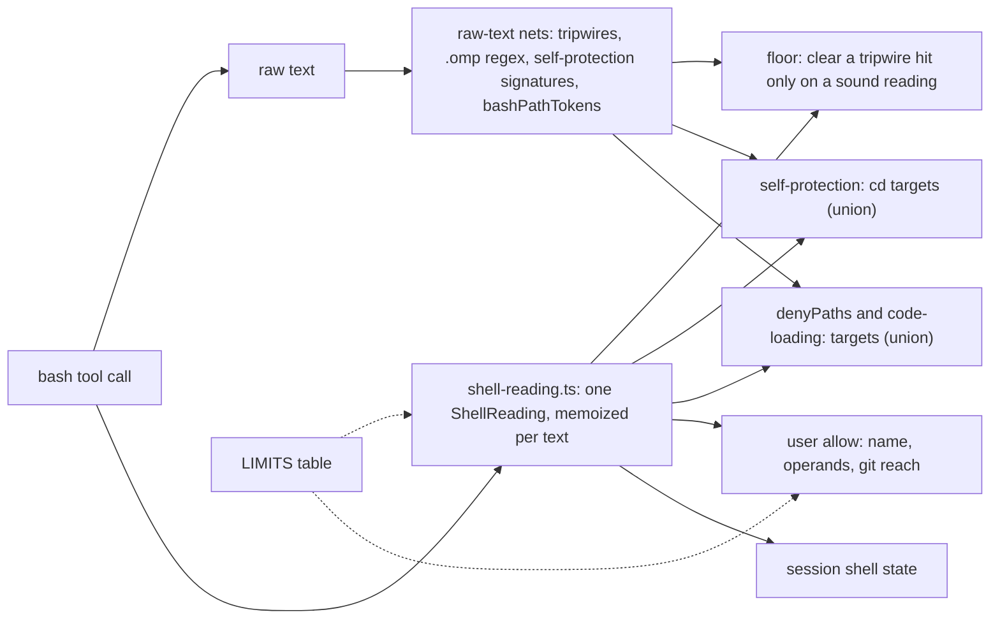

# 0012 - One shared reading of each shell command

---
status: proposed
date: 2026-11-02
---

## Context

A bash call reaches seven readers of its command text, and each reads it its own way:

| Reader | Module | How it reads the text |
| --- | --- | --- |
| Self-protection | `self-protection.ts` | substring signatures, plus its own `cd` parser (`bashDirectoryTargets`) |
| Floor | `shell.ts`, `shell-words.ts` | raw-text tripwires (ADR-0007), then `shellWords` to clear a hit, recursing into `sh -c` |
| `denyPaths` and the `.omp` gate | `deny-paths.ts` | `bashPathTokens`, a path-shaped token scanner, and the `.omp` regex |
| Code-loading ask | `code-loading.ts` | its own variable expansion, then `bashPathTokens` again |
| User `allow` | `shell.ts`, `allow-operands.ts`, `git-reach.ts` | `shellWords` in `allowAdmits`, and `shellWords` again for the operands |
| Session shell state | `shell-state.ts` | `shellWords` once per command, here-document bodies stripped first (ADR-0008) |
| Transcript redaction | `redaction.ts` | `bashPathTokens` over past calls |

The cost is not the problem: the whole rule layer takes 0.1 to 0.2 ms for a typical call and about 1 ms at the
8,192-character cap (measured 2026-11-02 on v0.23.0). The problem is divergence. Review rounds keep finding a
spelling that one reader understands and another does not, and each fix lands in one reader at a time.

The readers also lose facts they need. `shellWords` returns plain strings, so a later check cannot tell a literal
word from one that the shell will expand. That loss is behind the open gaps in `TODO.md` item 3: an unquoted `$(…)`
splits a command, process substitution `<(…)` is not marked unsound, brace expansion (`git {push,} origin +main`)
and `git push$NOPE` read as harmless words. Every allow and floor decision that depends on a word's meaning has to
guess.

cc-safety-net 2.7.1 (MIT) solves the static half of the same problem for about a dozen agent hosts
(`research/2026-11-02-cc-safety-net.md`). It parses each command once into words that keep their raw spelling, a
quoted flag and their provenance, gives the whole program one parse status, caches the parse for every check, and
holds every analysis cap in one table. It has no model, so its static rules must decide everything; pi-verdict keeps
static rules small and sound and sends the rest to the classifier (AGENTS.md "Goals").

## Decision

### 1. One reader, one structure

A new module `shell-reading.ts` reads a command into a `ShellReading`, in one linear pass:

```ts
interface ShellReading {
	readonly status: "sound" | "partial" | "unreadable";
	readonly commands: readonly SimpleCommand[]; // in order, with the operator that ends each
}
interface SimpleCommand {
	readonly assignments: readonly Word[]; // leading NAME=value words
	readonly name: Word | null;
	readonly args: readonly Word[];
	readonly redirects: readonly Redirect[]; // operator, target word, and a here-document body as data
	readonly end: ";" | "&&" | "||" | "|" | "|&" | "&" | "\n" | null;
	readonly grouped: boolean; // inside ( … ) or { … }
}
interface Word {
	readonly text: string; // quotes removed
	readonly raw: string; // as written
	readonly quoted: boolean;
	readonly literal: boolean; // no expansion of any kind
	readonly expansions: ReadonlySet<"variable" | "command" | "process" | "arithmetic" | "glob" | "brace" | "tilde" | "ansi-c">;
}
```

The reader models what `shellWords` models today (quotes, escapes, comments, line continuations, operators,
newlines, redirections) and adds provenance per word and here-document bodies kept as data. It does not evaluate
any expansion, build an abstract syntax tree of compound commands, or read PowerShell. `status` is `sound` when every
construct was read faithfully, `partial` when a construct was marked but not read (a command substitution, an
`eval`, a here-document fed to a shell), and `unreadable` when the reader stopped early (an unterminated quote, an
unsupported construct). `partial` and `unreadable` map to today's unsound sentinel: no check may clear a tripwire
hit or admit an allow on them.

### 2. Read once per call

`classifyByRules` builds the reading lazily on the call record it already builds (`readCall` in `rules.ts`), so a
call that never reaches a shell check never reads one. Every consumer takes the reading from there. A shell script
inside the command (`sh -c '…'`) is read through the same memo, keyed by its text.

### 3. The monotone rule covers every reader

ADR-0007 lets a sound word view clear a raw-text hit but never be the only path to one. This decision extends that
rule to every reader: the shared reading may add targets and hits to a layer, and may clear a raw-text hit only when
`status` is `sound`. The raw-text checks stay as nets: the floor's tripwires, the `.omp` regex, the self-protection
signatures and `bashPathTokens`. Where a layer takes targets from both, it takes their union, so no layer can grade
less than it does today.

### 4. Questions about words replace guesses

A layer asks a word what it is instead of re-deriving it: `literal` before admitting an operand, `expansions` before
reading a subcommand name, `quoted` before treating a word as an inert argument. A non-literal word in a position
whose meaning matters (a command name, a git subcommand, an operand under an allow) sends the call to the classifier.
This closes the expansion gaps in `TODO.md` item 3 in one place.

### 5. One table of limits

Every analysis cap moves into one frozen `LIMITS` table: the command length (`BASH_MAX_MATCH_LEN`), the operand cap
(`MAX_GRADED_OPERANDS`), the `sh -c` recursion depth, and the per-command cap of the shell-state record. A breach on
the current call raises one typed result that leads to the over-cap ask; a breach while recording history takes the
shell-state substring fallback.

### 6. Tests that prove the shape

The reader counts its work units, and a test asserts the count stays within a constant factor of the input length;
no test asserts on wall-clock time (`pv-tests.md`). A seeded generator builds commands from fragments (quotes,
substitutions, here-documents, wrappers) and checks invariants: no word holding an unquoted `$`, backtick, glob, brace
or tilde is `literal`, and every floor rule is reached at least once. Each accepted residual in ADR-0007, ADR-0008 and
ADR-0009 gets a probe case that pins today's route (ask, deny or classifier), so a silent regression to allow fails
the probe.



## Migration

Each step keeps every probe case's layer and verdict, unless the step names a change, and adds a probe check that
fails when any verdict moves from deny or ask toward allow.

1. Add `shell-reading.ts` and its unit, fuzz and work-count tests, with no consumer.
2. The floor's word view, `allowAdmits`, the allow operands and the session shell state read from the shared reading;
   their own calls to `shellWords` go. No behaviour change.
3. Move the caps into `LIMITS`. No behaviour change.
4. Close the item 3 expansion gaps through word provenance. Visible: some calls that cleared a tripwire now deny, and
   some allows now reach the classifier; disclosed in the CHANGELOG.
5. `denyPaths`, code-loading and self-protection take the reading's targets as a union with their raw-text
   extraction. Visible: more spellings reach the `denyPaths` ask; disclosed in the CHANGELOG.
6. Add the residual probe cases.

`shellWords` stays exported until step 2 has moved every caller, then becomes a thin view over the reading for the
exported API.

## Consequences

The readers stop disagreeing about word boundaries, quoting and command position, so a spelling fix lands once.
The item 3 expansion gaps close through one mechanism instead of four special cases. The caps become reviewable in
one place.

The cost is a medium-sized change to security code, done in six reviewed steps. The raw-text nets stay, so the gate
carries two readings of every command on purpose: the shared reading for meaning and the nets for safety. A command
the reader marks `partial` or `unreadable` keeps going to the classifier, as it does today.

Rejected: a full bash parser such as tree-sitter-bash or mvdan/sh compiled to WebAssembly, which would add a runtime
dependency, raise load time and still not know what a variable holds at run time; one combined regex or a
non-backtracking regex engine, which would keep the guessing or add a dependency; porting cc-safety-net's 1,816-line
POSIX parser, which serves a model-free design with more static rules than pi-verdict wants.
