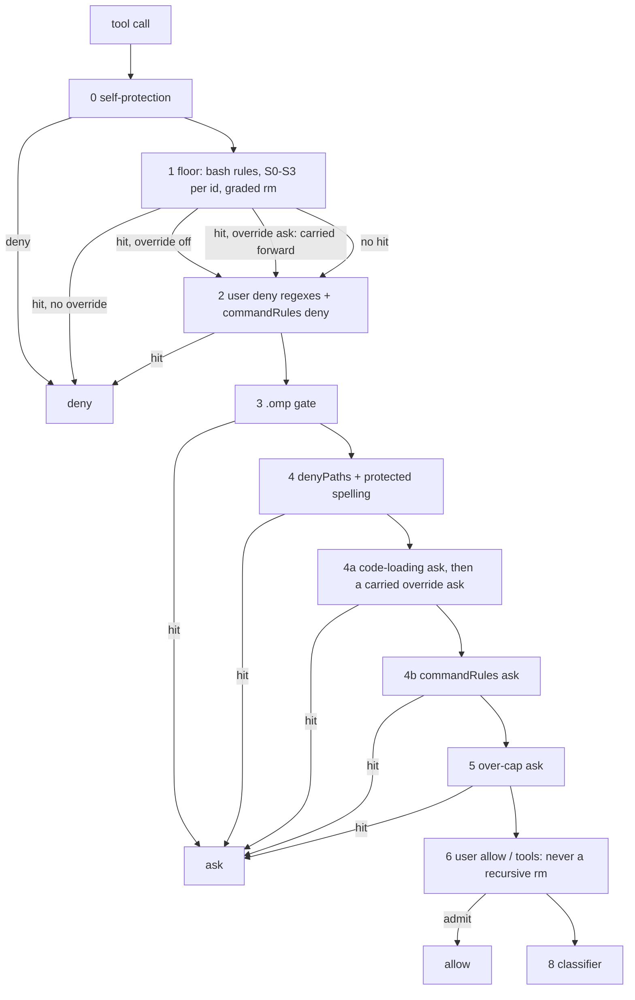

# 0013 - Configurable command rules, floor overrides, secret signatures and graded deletes

---
status: accepted
date: 2026-11-02
---

## Context

The user's own rules are regexes over raw text. A `deny` regex denies, an `allow` regex allows after operand grading
(ADR-0008), and `denyPaths` asks on a path. No user rule can make a command ask, and a regex cannot read a command's
words: `deny: ["push"]` also hits `echo "push"`, and a regex written for `git push` misses `git -C x push`.

The built-in floor is all or nothing. `builtinDenyFloor: false` turns off every bash floor rule, every path tier and
the code-loading ask at once. The floor also blocks more than it must, and in places less:

- The S0 tier denies every read and write of a `*.pem` file anywhere. Agents in one of the user's projects must handle
  `.pem` test keys, which today needs the whole floor off. cc-safety-net blocks the same files, and the user keeps a
  script to switch those rules off for that project.
- S0 also denies files that hold no secret: `.env.example`, `.env.sample`, `.env.template` and public keys such as
  `id_rsa.pub`. It lacks most key and vault extensions (`.key`, `.p12`, `.pfx`, `.jks`, `.keystore`, `.kdbx`, `.ovpn`,
  `.ppk`) and the `id_ed25519`, `id_ecdsa` and `id_dsa` key names outside `~/.ssh`.
- `rm-recursive` denies every `rm -r`, so `rm -rf node_modules` inside the project is a hard deny with no override.

The user runs cc-safety-net 2.7.1 beside pi-verdict and finds its setup works well. Its custom rules are declarative
rulebooks matched on command words, its built-in rules can be switched one by one, and its secret rules take
path-scoped exemptions. The user's agent-setup repository keeps about 50 such rules in two rulebooks, and its deployed
pi-verdict policy re-expresses most of them as about 55 `deny` regexes, which match quoted text and cannot express
"allowed with `systemctl --user`". `research/2026-11-02-cc-safety-net-rules.md` holds the inventory and the comparison.

On 2026-11-02 the user decided that a command rule may deny or ask, that one built-in rule may be switched off or
softened, that secret signatures grow and gain exemptions, and that recursive deletes are graded by target. A first
draft of this record was reviewed independently (`research/2026-11-02-adr-0013-review.md`); this text incorporates
that review's findings and the user's answers to the draft's three open questions.

## Decision

### 1. Command rules

A new user key, `commandRules`, holds rules in cc-safety-net's rulebook rule shape, with one added field:

```json
"commandRules": [
  { "name": "no-bulk-add", "command": "git", "subcommand": "add", "block_args": ["-A", "--all", "-u", "."],
    "action": "deny", "reason": "Name the paths: git add -- <paths>." },
  { "name": "system-restart", "command": "systemctl",
    "match": { "command_path": ["restart"], "exclude_args": ["--user"] }, "action": "ask",
    "reason": "Restarting a system unit changes the host." }
]
```

- **Shapes.** A rule with `match` takes cc-safety-net's version 2 shape (`match.command_path`, the leading non-option
  words in order, plus optional `match.any_args` and `match.exclude_args`); a rule without it takes the version 1 shape
  (`command`, optional `subcommand`, `block_args`). A rulebook file declares its shape with `rulebook_version`. `name`
  and `reason` are required; `action` is `deny` (the default) or `ask`; `intent` is accepted and ignored, so a
  cc-safety-net rule loads unchanged.
- **Matching.** A command rule is a `words` rule in the sense of ADR-0007. Its tripwire is generated from its fields and
  searched in order: the command name as a word, then the subcommand or each `command_path` word, then one of the
  `block_args` or `any_args` values standing alone as a word (bounded by whitespace, a quote, an operator or the end).
  When the tripwire hits, the word view decides through `anyCommandIn`:
  - it finds the command's basename at any word position of a segment, so every wrapper (`sudo`, `env`, `timeout -s KILL
    5`, `xargs`, `find -exec`, `ssh host …`) is looked through without a list;
  - it reads the subcommand or `command_path` after it past git's and docker's global options; past any option it cannot
    read, a later word equal to the next path word counts, so an unknown option fails closed;
  - a block value matches a word equal to it, or a short-option bundle holding it (`-Am` holds `-A`);
  - `exclude_args` clears a match only on a sound reading;
  - a word holding the tripwire's text outside a known inert position (`ssh h 'git add -A'`) matches; text the command
    never runs, such as an `echo` argument or a commit message, does not.
  When the word view is unsound (a here-document, a quoted command substitution), the tripwire hit alone decides. A
  `git commit -m "$(cat <<'EOF' …)"` therefore stays clear of a `git add .` rule, because its text holds no `add` word
  after `git`. The tripwire runs over the whole text, not the 8 192-character capped text, so a rule past the cap still
  applies its action.
- **Cost.** All command rules share one reading per call: the gate indexes the rules by command basename, tokenizes the
  call once, and tests only the rules whose command occurs in it. A call naming no ruled command pays one basename
  lookup. Rule count and field sizes are capped at load, as cc-safety-net caps them.
- **Pipeline position.** A deny rule runs in layer 2 beside the user `deny` regexes. An ask rule runs in a new layer 4b,
  after the code-loading ask (`Verdict.source` `rule`, `askSource` `rule`). Both run before user `allow`, so no allow
  rule or `tools` entry overrides them. An ask without a human (headless, or a subagent ask nobody answers) is a deny, as
  for every rule-layer ask.
- **Rule files.** `commandRuleFiles` names cc-safety-net `rulebook.json` files inside one directory,
  `<agentDir>/config/pi-verdict-rules/`; a path elsewhere is skipped and named. agent-setup deploys a copy of its
  rulebooks there (the user's choice; pi-verdict does not share cc-safety-net's own files). Self-protection denies agent
  writes to that directory by prefix in file tools and by the `pi-verdict-rules` name in shell commands. Files load with
  the config at session start and on a `/verdict` reload. Only a rulebook's `rules` are read; cc-safety-net's `rule.json`
  overrides are not honoured, which only keeps pi-verdict stricter. A rulebook's `tests` fixtures run in a verification
  tool, `bun run rules-verify`, which agent-setup's gate check calls; they never run at load.
- **Project config.** A trusted project may add inline `commandRules` only, which its trust hash covers (ADR-0006);
  it can neither remove a rule nor name rule files. Rules are never deduplicated across sources.
- **Errors.** A rule with an invalid or unknown field, an unreadable rule file, or a rule over a size cap is skipped,
  named in a notification, and sets `policyDegraded` (ADR-0010), as a skipped `deny` entry does. An unknown top-level
  rulebook field is ignored.
- **Ids.** A hit is recorded as `user-command:<rulebook>/<name>` (`user-command:<name>` inline) or
  `project-command:<name>`, in the compact deny records and, as a new field, in rule-layer ask records.

### 2. Floor overrides

A new user-only key, `floorOverrides`, changes one built-in rule by its id:

```json
"floorOverrides": {
  "gh-release": "ask",
  "S0:pem": { "action": "off", "paths": ["~/src/example-project/testdata/"] }
}
```

- **Actions.** `off` skips the rule; `ask` turns its deny into an ask. An override never allows a call by itself: a call
  whose rule is off continues to the later layers, and reaches the user rules, the floor's own path grade or the
  classifier like any call the floor does not deny. A user `allow` regex written while the floor caught a command (`^gh\b`
  with `gh-release` on) starts admitting it once the rule is off; `docs/configuration.md` says so beside the key.
- **Order.** A floor hit softened to `ask` does not end adjudication at layer 1. It is carried forward and applied after
  the code-loading ask in layer 4a, so the user's deny rules, the `.omp` gate and both protected-path asks decide first: a
  user deny still beats it, and a `denyPaths` hit keeps its path out of every model payload (ADR-0002).
- **Scope.** `paths` limits an override:
  - for a path rule, to targets whose every form the floor grades (lexical, rebuilt and kernel-walked) lies under a scope
    path;
  - for an `rm-*` rule, to calls whose every operand does, in the forms of decision 4;
  - for any other bash rule, to calls whose session cwd and command cwd both lie under a scope path, since an omp agent
    chooses its call's `cwd` argument.
  A scope path may not be the home directory or above it.
- **Per id.** The floor evaluates each id separately: a target that hits `S0:pem` and `S0:credentials` keeps the second
  deny when only the first is off. The grade is the worst result over every form and id that no applicable override
  lifts.
- **Ids.** Every bash floor rule keeps its id. The path tiers gain one id per entry: `S0:<name>` for each secret
  signature and credential home (`S0:pem`, `S0:env`, `S0:ssh`, `S0:credentials`), `S1`, `S3`. The code-loading ask is
  `code-loading`. `docs/configuration.md` lists every id.
- **Not overridable by `floorOverrides`.** Self-protection (a separate layer, ADR-0005), `rm-root`, `rm-git`,
  `S0:agent-db` (the agent's own credential store) and `unresolved-symlink` (a fail-closed mechanism, not a policy rule).
  Until decision 4 grades deletes by target, `rm-recursive` is not overridable either: it is the only rule that catches
  `rm -rf ~/` and `rm -rf /*`, which today's `rm-root` pattern misses. An override naming one of them, or an unknown id, is ignored with a notification, and the rule stays on. The two global
  switches keep their present meaning for these rules: `autoDeny: false` turns their deny into an ask, and
  `builtinDenyFloor: false` turns them off.
- **Visibility.** Active overrides show in the footer and in `/automode`, where ADR-0006 shows every widened state. An
  outcome an override changed is audited with `override:<id>`.
- **Project config.** User-only, like `builtinDenyFloor`: a project may not set it (ADR-0006). The scoped `paths` form
  gives one project its exemption.

### 3. Secret signatures

- **New signatures.** S0 adds the key and vault extensions `.key`, `.p12`, `.pfx`, `.jks`, `.keystore`, `.kdbx`, `.ovpn`
  and `.ppk`, and the private key names `id_ed25519`, `id_ecdsa` and `id_dsa` anywhere, each with its own id.
- **Exemptions.** S0 no longer matches `.env.example`, `.env.sample` or `.env.template`, or a public key name (`*.pub`).
  Each exemption is tested per form: a symlink named `.env.example` whose real path hits S0 still denies. Inside a
  credential home (`~/.ssh`) the `.pub` exemption lifts reads only.
- **Creation of key material.** A write that creates a key-material file (the extensions above, `.pem`, and the `id_*`
  key names outside a credential home) is graded gray, so the classifier sees it. A file is new when its lexical path
  fails `lstat` and no rebuilt or kernel-walked form exists, so a dangling or live symlink counts as existing. A write
  over an existing key file, every read, and every write to a credential home or a configuration signature (`.env*`,
  `.envrc`, `.netrc`, `.npmrc`, `.pypirc`, `credentials`, `.vault-token`) stay denied: those files can name a program
  the host or a tool runs. A PEM private-key block is redacted from the write's content excerpt before any model payload.
- **No vendor skip.** The signatures apply inside `node_modules` and vendor directories as well (the user's choice): a
  name-based skip would be a place where key files read freely.
- **Shell commands.** Unchanged: a shell command naming a signature file reaches the classifier or the user's
  `denyPaths`, and the user `allow` path refuses it through operand grading (ADR-0008).

### 4. Recursive deletes graded by target

`rm-recursive` becomes a `words` rule. Its tripwire is today's regex, widened to an abbreviated `--rec…` and a quoted
`'-rf'`. The project is the session cwd. A relative operand resolves from the command cwd, and is unreadable when that
directory is not exact. A leading `cd X &&` is first moved into the call's working directory, as omp itself does
(`src/tools/bash.ts:1020-1031`, omp 18.13.0); any other `cd` earlier in the command makes every relative operand
unreadable. Operands are read through `expandOperand` (`allow-operands.ts`), so a tilde other than `~` and `~/`, a brace,
a `$` and an over-cap glob are unreadable, and a glob expands only in one directory. Each match is graded in its lexical
form, in the real path of its parent directory and, when it ends in `/` or `/.`, in its own real path.

| Target, decided top down | Outcome | Id |
| --- | --- | --- |
| `/`, `//`, `/.`, home (`~`, `~/`, `$HOME`, `${HOME}`, quoted or not), any directory one level below `/`, `/System`, `/Library`, `/private/*`, an ancestor of one, or a glob whose literal prefix is one of them (`/*`, `~/*`, `~/.*`) | deny | `rm-root` |
| a `.git` directory, a path inside one, or a directory that contains the project's `.git` | deny | `rm-git` |
| an operand the gate cannot read | deny | `rm-unreadable-target` |
| a form outside the project and outside `/tmp`, `/var/tmp` and the trusted `$TMPDIR` | deny | `rm-outside-project` |
| every form strictly inside the project or a temp directory | gray: the classifier decides | none |

A session cwd that is home, an ancestor of home, `/` or a system directory has no inside, so every operand there is
`rm-outside-project`. The word view clears the tripwire only when every raw `rm` hit belongs to a simple command whose
operands were all graded; an `rm` in an argument position (after `xargs`, inside `-exec`) or an unsound view keeps the
deny. `allowAdmits` refuses an `rm` with a recursive flag, so no user `allow` rule admits a graded delete: in-project
data may be uncommitted work, and only the classifier sees the session's context. GNU `rm` crossing a mount point is an
accepted residual.

An agent's `cd` does not carry between calls: omp 18.13.0 runs each agent bash call in the call's own working directory
(`exec/bash-executor.ts:317-320`, `tools/bash.ts:1091`), and only the user's `!` shell keeps a `cd`. The native shell is
not read; the smoke test at each omp pin bump pins it (`cd /tmp` in one call, `pwd` in the next).

### 5. Where the changes sit



## Consequences

The user's cc-safety-net rulebooks load into pi-verdict nearly unchanged, and agent-setup can replace its ~55 `deny`
regexes with deployed rulebook copies once `rules-verify` passes their fixtures. A command rule can ask, which no user
rule could before. A single floor rule can be lifted for one project's paths instead of the whole floor. Fewer needless
denies remain: `.env.example`, public keys, newly created key files and in-project recursive deletes reach the
classifier instead.

The gate gains three config keys, a rules directory under self-protection, one layer (4b), a carried ask in 4a, per-id
evaluation of the path tiers, and a words rule for `rm`. Command rules add one tokenization per call that names a ruled
command. An override is a new way to widen the gate, so it is user-only, scoped by every form of a path, shown in the
footer, and barred from the catastrophic rules. The replay can count today's `rm-recursive` and `user-deny` denies but
cannot replay them, because compact records carry no input; the migration relies on the rulebook fixtures and
agent-setup's gate check instead.

Every change is pinned by probe cases, listed per slice under "Delivery".

## Alternatives considered

- **Regex rules with an `ask` flag.** Rejected: the regex weaknesses stay, and the rulebooks cannot be shared.
- **cc-safety-net's fail-open matching past an unknown option.** Rejected: the floor fails closed there, and a user rule
  should too.
- **Running fixtures at load.** Rejected: pi-verdict's matcher over-approximates, so an `allowed` fixture can fail while
  every rule loads, and under ADR-0010 that would withhold every model allow for the session.
- **Reading cc-safety-net's own rule files in place.** Rejected by the user: a deployed copy in a protected directory
  decouples the two tools.
- **cc-safety-net's safety levels.** Rejected for now: the classifier already judges what `strict` and `paranoid` would
  block statically, and `autoDeny: false` covers the softer direction.
- **Allowing in-project recursive deletes outright, as cc-safety-net does.** Rejected: a static rule may allow only when
  it can show the call is harmless (`AGENTS.md`, "Fast path in code").
- **Project-level overrides.** Rejected: a project config only narrows (ADR-0006); the user's scoped `paths` give one
  project its exemption.

## Delivery

Four slices, each with its probe cases, docs and CHANGELOG entry; `docs/layers.md` changes with the slice that moves a
layer.

1. **Ids and overrides.** `hitsS0` returns every hitting id per form; stable ids for every S0 entry; `floorOverrides`
   (user-only, outside the project direction table); the carried override ask; the footer and `/automode` listing; rule
   ids in rule-layer ask records. Probe: each action, each scope kind, a symlinked scope escape, a user deny and a
   `denyPaths` hit beating an override ask, each non-overridable id.
2. **Signatures.** The new key-material ids, the per-form exemptions, the creation rule with its existence test, the
   excerpt redaction. Probe: a created and an overwritten key file, a `.pub` symlink to a private key, creating
   `~/.ssh/authorized_keys` staying a deny.
3. **Graded delete.** Export `expandOperand`; the widened tripwire; operand grading against the session-cwd project; the
   `rm-root` spellings; the `allowAdmits` refusal; the leading-`cd` extraction. Probe: each target class, `/*`, `~/*`,
   `$HOME`, a symlinked `vendor/lib`, `link/`, `xargs rm -r`, a `cwd` argument at home, a session cwd at home, a `^rm\b`
   allow refused.
4. **Command rules.** The loader for inline rules and the rules directory, shape detection, caps, ids, the project inline
   union, one tokenization per call with the basename index, the generated tripwire, `bun run rules-verify`, the
   self-protection entry. Probe: each shape, quoted and `sh -c` text, a heredoc commit with a `git add .` rule staying
   clear, an unknown option before the path, a rule past the length cap, a project-added rule, a rule-file edit through
   `cd` denied.

After the release, agent-setup deploys its rulebook copies, runs `rules-verify` in its gate check, and removes the
regexes the rulebooks replace.
