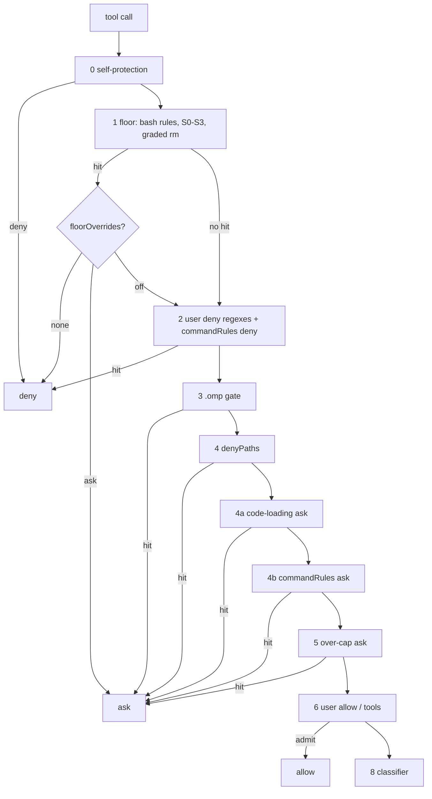

# 0013 - Configurable command rules, floor overrides, secret signatures and graded deletes

---
status: proposed
date: 2026-11-02
---

## Context

The user's own rules are regexes over raw text. A `deny` regex denies, an `allow` regex allows after operand grading
(ADR-0008), and `denyPaths` asks on a path. No user rule can make a command ask, and a regex cannot read a command's
words: `deny: ["push"]` also hits `echo "push"`, and a regex written for `git push` misses `git -C x push`.

The built-in floor is all or nothing. `builtinDenyFloor: false` turns off every bash floor rule, every path tier and
the code-loading ask at once. The floor also blocks more than it must:

- The S0 tier denies every read and write of a `*.pem` file anywhere. Agents in one of the user's projects must handle
  `.pem` test keys, which today needs the whole floor off. cc-safety-net blocks the same files, and the user has kept
  a script to switch those two rules off for that project.
- S0 also denies files that hold no secret: `.env.example`, `.env.sample`, `.env.template` and public keys such as
  `id_rsa.pub`. S0 lacks most key and vault extensions (`.key`, `.p12`, `.pfx`, `.jks`, `.keystore`, `.kdbx`,
  `.ovpn`, `.ppk`).
- `rm-recursive` denies every `rm -r`, so `rm -rf node_modules` inside the project is a hard deny with no override.

The user runs cc-safety-net 2.7.1 beside pi-verdict and finds its setup works well. Its custom rules are declarative
rulebooks matched on command words, its built-in rules can be switched one by one, and its secret rules take
path-scoped exemptions. The user's agent-setup repository keeps about 50 such rules in two rulebooks, and its deployed
pi-verdict policy re-expresses most of them as about 55 `deny` regexes, which match quoted text and cannot express
"allowed with `systemctl --user`". `research/2026-11-02-cc-safety-net-rules.md` holds the inventory and the comparison.

The user decided on 2026-11-02 that a command rule may deny or ask, that one built-in rule may be switched off or
softened, that secret signatures grow and gain exemptions, and that recursive deletes are graded by target. This
record designs those four changes.

## Decision

### 1. Command rules

A new user key, `commandRules`, holds rules in cc-safety-net's rulebook rule shape, with one added field:

```json
"commandRules": [
  { "name": "no-bulk-add", "command": "git", "subcommand": "add", "block_args": ["-A", "--all", "-u", "."],
    "action": "deny", "reason": "Name the paths: git add -- <paths>." },
  { "name": "system-restart", "command": "systemctl",
    "match": { "command_path": ["restart"], "exclude_args": ["--user"] }, "action": "ask",
    "reason": "Restarting a system unit changes the host." }
]
```

- **Shapes.** A version 1 rule names `command`, an optional `subcommand` and `block_args`. A version 2 rule names
  `match.command_path` (the leading non-option words, in order), `match.any_args` and `match.exclude_args`. `name`
  and `reason` are required; `action` is `deny` (the default) or `ask`. An `intent` field is accepted and ignored, so a
  cc-safety-net rule loads unchanged.
- **Matching.** A rule is tested against every simple command of the call, as the floor reads them: through
  `shellWords`, in every segment of a chain or pipeline, inside `sh -c` and `bash -c` text, and past the transparent
  wrappers `env`, `command`, `nice`, `nohup`, `time`, `timeout` and `stdbuf`. The command word matches by basename. A
  version 1 subcommand is read past git's and docker's global options and their values, with git's long-option
  abbreviations. An argument matches a `block_args` value when it equals it or, for a short option, when a bundle
  contains it (`-Am` holds `-A`). Text the command never runs, such as an `echo` argument or a commit message, does not
  match.
- **Fail direction.** A rule follows ADR-0007: its tripwire is its command name as a word in the raw text, and the word
  view may only clear the hit. When the word view is unsound (a here-document, an unreadable expansion or word), a
  command whose name appears in the raw text matches if any of its `block_args`, `command_path` or `any_args` values
  also appears; `exclude_args` cannot clear an unsound call.
- **Pipeline position.** A deny rule runs in layer 2 beside the user `deny` regexes; an ask rule runs right after the
  code-loading ask (layer 4b, `Verdict.source` `rule`, `askSource` `rule`). Both run before user `allow`, so no allow
  rule or `tools` entry overrides them. An ask without a human (headless, or a subagent ask that nobody answers) is a
  deny, as for every rule-layer ask.
- **Files.** `commandRuleFiles` lists cc-safety-net `rulebook.json` files by path; their `rules` load as if written
  inline, and their `tests` fixtures run at load (a failing fixture is a load error). The gate's self-protection layer
  denies agent writes to every listed file, because deleting a rule there widens the gate.
- **Project config.** A trusted project may add rules and rule files (a union, ADR-0006), never remove one.
- **Errors.** An invalid rule or an unreadable rule file is skipped, named in a notification and sets
  `policyDegraded` (ADR-0010), as a skipped `deny` entry does.
- **Records.** The audit and the replay record a hit as `user-command:<name>`.

### 2. Floor overrides

A new user-only key, `floorOverrides`, changes one built-in rule by its id:

```json
"floorOverrides": {
  "gh-release": "ask",
  "S0:pem": { "action": "off", "paths": ["~/src/example-project/testdata/"] }
}
```

- **Actions.** `off` skips the rule, so the call continues to the later layers; `ask` turns its deny into a rule-layer
  ask. An override never allows a call by itself: a call whose floor rule is off reaches the user rules, the floor's
  own path grade or the classifier, as any call the floor does not deny.
- **Scope.** `paths` limits an override to calls whose every target lies under one of the paths (for a path rule) or
  whose working directory does (for a bash rule). Paths are graded with `baseForms`, so a symlink cannot widen them; a
  path may not be the home directory or above it.
- **Ids.** Every bash floor rule keeps its id. The path tiers gain one id per entry: `S0:<name>` for each secret
  signature and credential home (`S0:pem`, `S0:env`, `S0:ssh`), `S1`, `S3`. The code-loading ask is
  `code-loading`. `/automode` lists the active overrides.
- **Not overridable.** Self-protection (a separate layer, ADR-0005), the recursive deletes of root, home and `.git`
  (decision 4), and `S0:agent-db`, the agent's own credential store. An override naming one of them, or an unknown id,
  is ignored with a notification; the rule stays on.
- **Project config.** User-only, like `builtinDenyFloor`: a project may not set it (ADR-0006). The scoped `paths` form
  is how one project gets an exemption.

### 3. Secret signatures

- **New signatures.** S0 adds `.key`, `.p12`, `.pfx`, `.jks`, `.keystore`, `.kdbx`, `.ovpn` and `.ppk`, each with its own
  `S0:<ext>` id.
- **Exemptions.** S0 no longer matches `.env.example`, `.env.sample`, `.env.template`, or a public key (`*.pub`,
  including `id_rsa.pub`).
- **Creation.** A read of a signature file stays a deny. A write that creates a file that does not exist yet is graded
  gray, so the classifier sees it; a write over an existing one stays a deny. The existence check uses the target's
  kernel walk, which the floor already performs.
- **Shell commands.** Unchanged: a shell command naming a signature file reaches the classifier or the user's
  `denyPaths`, and the user `allow` path refuses it through operand grading (ADR-0008).

### 4. Recursive deletes graded by target

`rm-recursive` becomes a `words` rule. Its tripwire is today's regex; the word view grades each operand of an `rm` with
a recursive flag, resolved from the command's working directory:

| Target | Outcome | Id |
| --- | --- | --- |
| `/`, the home directory, a system directory (`/etc`, `/usr`, `/var` …), or an ancestor of one | deny, not overridable | `rm-root` |
| a `.git` directory, a path inside one, or a directory that contains the project's `.git` (the project root itself) | deny, not overridable | `rm-git` |
| a path outside the project and outside the temp directories | deny | `rm-outside-project` |
| an operand the gate cannot read (a variable, a substitution, a glob whose literal prefix is not inside the project) | deny | `rm-unreadable-target` |
| a literal path inside the project, or inside `/tmp`, `/var/tmp` or the trusted `$TMPDIR` | gray: the classifier decides | none |

An earlier `cd` in the same command makes every relative operand unreadable. An unsound word view keeps the deny. A
rule allow never follows from this grading: in-project data may be uncommitted work, and only the classifier sees the
session's context.

### 5. Where the changes sit



## Consequences

The user's cc-safety-net rulebooks load into pi-verdict nearly unchanged, and agent-setup can replace its ~55 `deny`
regexes with the rulebook files themselves. A command rule can ask, which no user rule could before. A single floor
rule can be lifted for one project's paths instead of the whole floor for every project. Fewer needless denies remain:
`.env.example`, public keys, new key files and in-project recursive deletes reach the classifier instead.

The gate gains three config keys, one layer (4b), finer rule ids for the path tiers, and a words rule for `rm`. Each
command rule costs one pass over the word view the floor already builds; a call with no rules pays nothing. An
override is a new way to widen the gate, so it stays user-only, scoped by paths, and exempt for the catastrophic
rules. Rule files outside the agent directory join the self-protection set.

Every change is pinned by probe cases: each rule shape, the quoted-text and `sh -c` cases, an unsound command, a
project-added rule, each override action and its path scope, each non-overridable id, each new signature and
exemption, a created and an overwritten key file, and each `rm` target class.

## Alternatives considered

- **Regex rules with an `ask` flag.** Rejected: the regex weaknesses stay, and the rulebooks cannot be shared.
- **cc-safety-net's safety levels.** Rejected for now: pi-verdict's classifier already judges what `strict` and
  `paranoid` would block statically, and `autoDeny: false` covers the softer direction.
- **Allowing in-project recursive deletes outright, as cc-safety-net does.** Rejected: a static rule may allow only
  when it can show the call is harmless (`AGENTS.md`, "Fast path in code").
- **Project-level overrides.** Rejected: a project config only narrows (ADR-0006); the user's scoped `paths` give one
  project its exemption.

## Open questions

1. Should `commandRuleFiles` read cc-safety-net's rulebook files in place (shared with cc-safety-net), or should
   agent-setup deploy a copy for pi-verdict? Reading in place keeps one source of truth, and the self-protection
   entry covers the shared file for omp agents only.
2. Does omp's persistent shell move the session cwd after an agent's `cd` (omp 18.13.0
   `exec/bash-executor.ts:551`)? If it does, relative `rm` operands resolve from a directory the gate may not know,
   and decision 4 must treat a session-level `cd` (recorded by the shell-state guard, ADR-0008) as making relative
   operands unreadable.
3. Should the broad signatures skip `node_modules` and vendor directories, as cc-safety-net does, where `.pem` files
   are CA bundles?

## Delivery

Four slices, each with its probe cases, docs and CHANGELOG entry: (1) rule ids for the path tiers and
`floorOverrides`; (2) the secret signatures, exemptions and the creation rule; (3) the graded `rm` rule;
(4) `commandRules` and `commandRuleFiles`, followed by agent-setup's migration.
