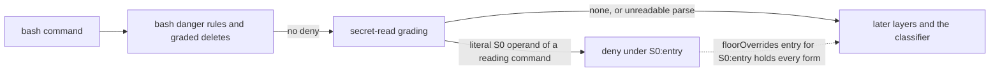

# 0014 - The floor denies a shell command that reads a secret file

---
status: proposed
date: 2026-11-10
---

## Context

The S0 tier of the floor denies reading or writing a credential file (`.env`, `*.pem`, `id_rsa`, `~/.ssh/…`
and the others listed in `docs/configuration.md`). It grades only the targets of the tool-access adapter: the
paths of `read`, `write`, `edit`, `grep` and the other file tools. A bash command is no tool-access target, so
`cat .env`, `source .env`, `cat x.pem`, `cat ./credentials.json` and `cat /proc/self/environ` pass the floor and
reach the classifier, which may allow them. A credential file under a `denyPaths` entry only asks.

ADR-0008 chose this on purpose. Its section "Why not a floor deny" says that the S0 patterns as a bash deny would
also hit commands that name a key without printing it (`ssh -i ~/.ssh/id_x host`, `ssh-keygen -f key`). User
allows therefore grade operands only to refuse an admission, and the classifier decides.

agent-setup's gate check for the deployed omp policy showed the cost on 2026-11-10. The policy keeps about ten
hand-written deny regexes for these shapes, and each of the shapes above reached the classifier without them.
Those regexes match raw text, so they also deny a commit message or an `echo` that names `.env`. A user without
such regexes has no static protection against an agent printing a secret through the shell.

## Decision

The floor denies a bash command that reveals or copies the content of a file the S0 tier protects, when the
command names that file literally. Every other command that names a secret is graded as today. This narrows
ADR-0008's "Why not a floor deny" to the commands that name a key without printing it.

### What counts as reading

A simple command reads its file operands when its command word is one of these:

- **Readers** print or transform content: `cat`, `tac`, `nl`, `head`, `tail`, `less`, `more`, `bat`, `batcat`,
  `od`, `xxd`, `hexdump`, `strings`, `base64`, `base32`, `cut`, `sort`, `uniq`, `diff`, `cmp`, `comm`, `paste`,
  `tr`, `fold`, `column`, `grep`, `egrep`, `fgrep`, `rg`, `ag`, `sed`, `awk`, `gawk`, `jq`, `yq`.
- **Copiers** put the content where a later command can read it: `cp`, `mv`, `scp`, `rsync`, `tar`, `zip`, `7z`.
  Every operand counts, the destination included, so `cp .env /tmp/x` and `cp x.pem .ssh-copy/` both deny.
- **Loaders** put the content into the shell's environment, where `env` prints it later: `source` and `.`, with
  their first operand only.
- **An upload** sends the content off the machine: `curl` and `wget` with a `@file` data value (`-d @.env`,
  `--data-binary @x.pem`, `-F f=@.env`) or `-T`/`--upload-file`.

Input redirected from a secret (`cmd < .env`, `cmd 0< .env`) reads it whatever the command is. A here-string or a
here-document is no file and is not graded.

For `grep`, `egrep`, `fgrep`, `rg`, `ag`, `sed`, `awk`, `gawk`, `jq` and `yq`, the first positional word is a
pattern, a script or a filter, not a file, unless an option already supplied it (`-e`, `--regexp`, `-f`,
`--file`, `--expression`). That word is skipped, so `grep .env README.md` and `jq .env x.json` search for the
text `.env` and pass. The value of `-f`/`--file` is a file the command reads, so `grep -f .env x` denies.

The reading command may sit anywhere in a segment, so a wrapper is looked through (`sudo cat .env`,
`timeout 5 cat .env`, `xargs cat`), as command rules do (ADR-0013). A word the shell-word view marks inert, such
as an `echo` argument or a commit message, is not a command word. An `sh -c` script is read the same way, through
`anyCommandIn`.

### How an operand is graded

Each operand of a reading command is expanded by `expandOperand`, the function user allows use (ADR-0008): a
leading `~`, `$HOME` and `${HOME}` are expanded, `=`-attached values (`if=.env`) and the attached value of a short
option are collected the same way, and a glob with no `/` matches the entries of the command's directory. The
expanded path is then graded by `classifyPath` as a read. The call denies when any operand grades an S0 deny, with
that entry's id (`S0:env`, `S0:pem`, `S0:ssh` …) and the reason `rule S0:<entry>: shell command reads a secret
file`.

The S0 exemptions hold as they do for a file tool: `.env.example`, `.env.sample`, `.env.template` and a `.pub`
key are no secret, so `cat .env.example` passes. Most S0 entries match a file name anywhere, so the working
directory rarely matters; a relative operand resolves against the command's own `cwd` argument, as user allows
resolve it.

Two choices differ from the allow side, because there an over-match only costs a classifier call and here it
denies:

- A glob matches non-hidden entries only, as bash does by default. `cat *` in a directory holding `.env` passes;
  `cat *.pem` and `cat .env*` are graded on their matches. The allow side matches hidden entries too, because
  `dotglob` may be on; here a session that turned it on is a residual.
- An operand the gate cannot expand exactly (`cat $F`, `cat ~user/x`, `cat {a,b}.env`) is not denied. It goes to
  the classifier, as it does today.

### Where it runs

The grading is part of layer 1, after the bash danger rules and the graded deletes. It is off with
`builtinDenyFloor: false`, like the rest of the floor. A `floorOverrides` entry for the S0 id lifts it when its
scope holds every form of the operand, as for a delete target (ADR-0013), so a scoped `S0:pem` entry for a
project's test-key folder lifts `cat test-keys/x.pem` and a `read` of the same file alike. The audit's compact
record carries the same `S0:<entry>` id as a file-tool deny.

### Fail direction

The grading only adds denies; it never allows. Every case it cannot decide passes to the later layers as today:
an unsound parse, an `eval`, an operand that may expand, a command over `BASH_MAX_MATCH_LEN`. The floor's
existing tripwires still decide those.

### Cost

The command is already split into words for the danger rules; the grading walks those words once more. Name
patterns are tested on every literal operand, which is linear in the command's length. The file-system forms of
`classifyPath` (realpath, ancestor rebuild) are computed for the first `MAX_GRADED_OPERANDS` operands only, so a
glob over a large directory stays cheap. The shared reading of each call (ADR-0012, TODO item 5) would later fold
this walk into its single reading.

### Implementation notes

- `shellWords` drops a redirection with its target word. The input-redirection target must be kept for this
  grading, either as an annotation beside the words or by a separate linear scan, without changing what the
  existing word view returns.
- The grader is bound to the call's directories by the rule layer and passed to `classifyBash`, as the
  `DeleteGrader` is (`shell.ts`). It returns one hit per denied operand with its forms, so `floorOverrides`
  scoping reuses the delete path.
- `MAX_GRADED_OPERANDS` and the reading-command table live in one place, beside the allow side's tables.

## Alternatives considered

- **Deny any command that names a secret.** Simple, and it is what the deployed omp regexes do. It denies
  `ssh -i`, `ssh-keygen -f`, `chmod 600 x.pem`, `ls .env` and `docker run --env-file .env`, the false denies
  ADR-0008 named. Rejected by the user on 2026-11-10.
- **Ask instead of deny.** A human would confirm each such command. Headless sessions would deny anyway, and an
  interactive user would be asked for commands that are almost never legitimate. A needless ask is a defect
  under the project's goals. Rejected by the user on 2026-11-10.
- **Pass a secret to a program without printing it** (`docker run --env-file .env`, `node --env-file=.env`,
  `dotenv run`). These are ordinary ways to run code with its secrets; the classifier decides them. Decided by
  the user on 2026-11-10.

## Consequences

- `cat .env`, `source .env`, `head x.pem`, `cp .env /tmp/x`, `grep -f .env x`, `curl -d @.env url` and
  `cmd < .env` deny under an S0 id. `cat .env.example`, `grep .env README.md`, `ssh -i ~/.ssh/id_x host` and
  `docker run --env-file .env img` are graded as before.
- A policy that kept deny regexes for these shapes can drop them; their gate-check pins move from `user-deny` to
  the S0 ids. agent-setup's omp policy keeps about ten such regexes.
- A call a user allow admitted is unaffected, because ADR-0008 already refuses an allow for a secret operand. A
  call the classifier used to allow, such as an agent reading `.env` to debug a configuration, now denies; a
  scoped `floorOverrides` entry for its S0 id lifts it.

### Residuals (ADR-0009)

- A reading command the table does not list (`python -c "print(open('.env').read())"`, `vim .env`, `perl`,
  `node -e`), and a Python `eval` cell, whose shell lines get the raw-text view only. The classifier decides
  them, and the OS sandbox is the backstop.
- An operand built from an expansion, or a glob under `dotglob`, `nocaseglob` or `GLOBIGNORE`.
- A secret file whose name matches no S0 entry.
- A shell write over a secret through a redirection or `tee` (`echo x > .env`, `tee .env`); `cp a .env` denies
  as a copy. Shell writes to S0 files are a separate question.
- `grep -r x ~` and other recursive reads that walk into a credential home; user allows refuse them (ADR-0008,
  "Recursive commands"), and the floor does not deny them.
- PowerShell commands (`Get-Content .env`).
- A symlink to a secret beyond the first `MAX_GRADED_OPERANDS` operands, graded by its lexical form only.
