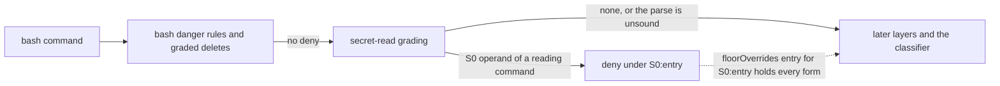

# 0014 - The floor denies a shell command that reads a secret file

---
status: proposed
date: 2026-11-10
---

## Context

The S0 tier of the floor denies reading or writing a credential file (`.env`, `*.pem`, `id_rsa`, `~/.ssh/…`
and the others listed in `docs/configuration.md`). It grades only the targets of the tool-access adapter: the
paths of `read`, `write`, `edit`, `grep` and the other file tools. A bash command is no tool-access target, so
`cat .env`, `source .env`, `cat x.pem`, `cat ./credentials.json` and `cat /proc/self/environ` pass the floor and
reach the classifier, which may allow them. A credential file under a `denyPaths` entry only asks.

ADR-0008 chose this on purpose. Its section "Why not a floor deny" says that the S0 patterns as a bash deny would
also hit commands that name a key without printing it (`ssh -i ~/.ssh/id_x host`, `ssh-keygen -f key`). User
allows therefore grade operands only to refuse an admission, and the classifier decides.

agent-setup's gate check for the deployed omp policy showed the cost on 2026-11-10. The policy keeps about ten
hand-written deny regexes for these shapes, and each of the shapes above reached the classifier without them.
Those regexes match raw text, so they also deny a commit message or an `echo` that names `.env`. A user without
such regexes has no static protection against an agent printing a secret through the shell.

## Decision

The floor denies a bash command that reveals, copies out or uploads the content of a file the S0 tier protects,
when the command names that file literally as a file it reads. Every other command that names a secret is graded
as today. This narrows ADR-0008's "Why not a floor deny" to the commands that name a key without printing it.

The grader has its own operand reader. The allow side's `operandWords` collects too much on purpose (every
non-option word, every text after `=`, the text after a short option's first `/`), because there an over-match
costs only a classifier call. Here it would deny `scp -i ~/.ssh/deploy_key …` and `rsync --exclude=.env …`.

### Reading commands and the words they read

Each reading command has an entry in one table, `SECRET_READERS`. An entry names the command's file-reading
positions and its options that take a value, so a value is skipped unless the option reads that file:

- **Readers** print or transform content; every positional word is a file it reads: `cat`, `tac`, `nl`, `head`,
  `tail`, `less`, `more`, `bat`, `batcat`, `od`, `xxd`, `hexdump`, `strings`, `base64`, `base32`, `cut`, `sort`,
  `uniq`, `diff`, `cmp`, `comm`, `paste`, `fold`, `column`. The value of `dd if=` is a file it reads.
- **Pattern readers** take a pattern, script or filter first, then files: `grep`, `egrep`, `fgrep`, `rg`, `ag`,
  `sed`, `awk`, `gawk`, `jq`, `yq`. The first positional word is skipped unless `-e`/`--regexp`, `-f`/`--file` or
  `--expression` supplied the pattern; a `-e` value is a pattern and is not graded. yq's subcommand word (`e`,
  `eval`, `ea`, `eval-all`) is skipped before its filter. The value of `-f`/`--file`, `jq --slurpfile`/`--rawfile`
  (second value) and `jq --from-file` is a file the command reads; `jq --arg`/`--argjson` take two values that are
  not files.
- **Copiers** put the content where a later command can read it, and only their sources are graded: `cp`, `mv`,
  `scp`, `rsync` (every positional but the last, or every positional when `-t`/`--target-directory` names the
  destination), `tar` in create mode (the files after the options; the `-f` archive is not graded), `zip` (every
  positional after the archive name), `7z a` (likewise). tar's append and update modes (`r`, `u`) read their
  files as create mode does. An old-style tar bundle (`tar czf out.tgz .env`) is read as options, and its `f`
  takes the next word as the archive. zip's `-x` and `-i` take a list that runs to the next option word, so
  `zip -r a.zip . -x .env '*.pem'` grades nothing after `-x`. A destination is a write, which is a separate question,
  so `cp .env.example .env` passes.
- **Loaders** put the content into the shell's environment: `source` and `.`, first positional only. omp keeps
  one shell per session, so a loaded secret stays in that shell, where a later `env` prints it; that is why
  `source .env` denies while `docker run --env-file .env` goes to the classifier.
- **Uploads** send the content off the machine: curl's `-d`/`--data`/`--data-binary`/`--data-ascii`/`--json` and
  `-H` with an `@file` value, `--data-urlencode` with `@file` or `name@file`, `-F` with `name=@file` or `name=<file`,
  `-T`/`--upload-file`; wget's `--post-file` and `--body-file`; `gh gist create` and its file
  operands. curl's `--data-raw` sends its text literally and is not graded.
- **`xargs`** is a wrapper whose command is found after its options, and its `-a`/`--arg-file` value is a file
  it reads, so `… | xargs cat .env` and `xargs -a .env echo` both deny.

Every option in an entry's value table has its value skipped (`grep -C 3 .env README.md` reads `README.md` only;
`rsync -e "ssh -i deploy.pem"` and `--exclude .env` are skipped). An option the table does not know is read as a
flag without a value; a missing value-taking option can only add a false deny, which the probe cases catch.

Input redirected from a file reads it, whatever the command is: `<`, `N<` and `<>` count (`cmd < .env`,
`cmd 0< .env`). `<&` duplicates a descriptor, `<<` and `<<<` are a here-document and a here-string, and `<(` is a
process substitution; none of them names a file, so none is graded.

### Where a reading command is found

The reading command may sit at the command position of a segment or behind a wrapper (`sudo`, `env`, `timeout`,
`nice`, `time`, `command`), and its operands are the words after it in that segment. One pass over each segment
finds the first word that is a reading command and is not marked inert by the shell-word view, so an `echo`
argument or a commit message is never a command word. An `sh -c` script is read the same way, through
`anyCommandIn`. A command run on another host counts as a reader too: `ssh prod cat /app/.env` denies, since
the operand is graded locally by its name; the quoted `ssh prod 'cat /app/.env'` is one word and passes.

### How an operand is graded

Each graded word is expanded as user allows expand it (ADR-0008): a leading `~`, `$HOME` and `${HOME}`. A
relative word resolves against the directory the command runs in, which `commandWorkingDirectory`
(`delete-grade.ts`) computes from the call's `cwd` and a leading `cd X &&`; so `cd ~/.kube && cat config` denies.
When that directory is unknown (another directory change, `CDPATH`, a session that voided it), a relative word
is graded by name only: its literal text is tested against every S0 entry that is not anchored to an absolute
path, so `cd ~; cat .ssh/config` still denies through the `.ssh/` entry.

The expanded path is graded by `classifyPath` as a read. The call denies when any word grades an S0 deny, with
that entry's id (`S0:env`, `S0:pem`, `S0:ssh` …) and the reason `rule S0:<entry>: shell command reads a secret
file`. The S0 exemptions hold as for a file tool: `.env.example`, `.env.sample`, `.env.template` and a `.pub` key
are no secret, so `cat .env.example` passes.

A word whose directory part holds a variable or a glob but whose tail is literal (`cat "$PWD/.env"`,
`cat $DIR/x.pem`, `cat "$ROOT/.ssh/config"`, `cat apps/*/.env`) is graded by name only on the literal text after
the last expansion, as above. Any other expansion
(`cat $F`, `cat ~user/x`, `cat {a,b}.env`) is not graded; the classifier decides it, as today.

Globs are expanded in a deny-side mode that follows bash's defaults, because an over-match here denies:

- The pattern may sit in the last path segment of any literal directory (`cat certs/*.pem`).
- `*` and `?` do not match a leading dot, but a pattern that starts with `.` does (`cat .env*` matches `.env` and
  `.env.local`); `.` and `..` never match.
- The match is case-sensitive.
- A pattern that matches nothing denies nothing (bash passes it through literally, and the command fails).

A session that turned on `dotglob`, `nocaseglob` or `GLOBIGNORE` is a residual. The allow side keeps its own mode,
which matches hidden entries and ignores case, because there an over-match only refuses an allow.

### Overrides and audit

The grading is part of layer 1, after the bash danger rules and the graded deletes. It is off with
`builtinDenyFloor: false`, like the rest of the floor. A `floorOverrides` entry for the S0 id lifts it when its
scope holds every canonical form `classifyPath` computes for the operand, the real path of a symlink at the end
included, so a scoped `S0:pem` entry for `test-keys/` does not lift `cat test-keys/live.pem` when that file links
to a key elsewhere. A word graded only by its name (an unknown directory, or past the operand budget) can be
lifted only by an unscoped entry. The audit's compact record carries the same `S0:<entry>` id as a file-tool deny.

### Fail direction

The grading only adds denies; it never allows. Every case it cannot decide passes to the later layers as today:
an operand that may expand, and a command over `BASH_MAX_MATCH_LEN`, which is not graded at all, since a word cut
at the cap (`.env.example` cut to `.env`) would deny falsely. The floor's tripwires still decide those calls.

An unsound construct (a here-document, a backtick, `$'…'`, an `eval`) makes the word view stop trusting the rest
of the command. The segments that end before the first unsound word are still graded, so
`set -a; source .env; set +a; python3 - <<'EOF'` denies on its `source .env`. A command substitution inside
double quotes (`TOKEN="$(grep '^TOKEN=' .env | cut -d= -f2)"`) is the one unsound spelling an agent writes
often; its body, found by a linear scan for the balancing `)`, is graded as a nested script. Everything from the
first other unsound word on is not graded.

### Cost

The grading reads the command once more with `anyCommandIn`, which tokenizes it once and visits each segment once.
Finding the reading command is one pass over the segment's words with a set lookup per word, and its operands
are the words after it, so the walk is linear in the command's length. Name patterns are tested on every graded
word. The file-system work shares one budget per call: `classifyPath`'s canonical forms for at most
`MAX_GRADED_OPERANDS` words and one directory read per distinct glob directory, cached for the call. Past the
budget, words are graded by their names only. The shared reading of each call (ADR-0012, TODO item 5) would later
fold this pass into its single reading.

### Implementation notes

- The grader lives in its own module, `secret-reads.ts`, with `SECRET_READERS` and its budget. The rule layer
  binds it to the call's directories and passes it to `classifyBash`, as it does the `DeleteGrader`.
- `shellWords` drops a redirection with its target word, and it is a public export. A new tokenizer-level
  function returns the input-redirection targets beside the words, so the existing word view does not change.
- Before its branch merges, the build runs `bun run replay` there. The count of recorded gray-zone calls that now
  deny under an S0 id is an upper bound on the false denies, since it also counts the true ones. The user reviews
  the `--show` list, which only they can run in a terminal, before the merge.

### S0 entries that over-match

S0 already denies a `read` of some ordinary files, and this ADR extends that to their shell reads, where an agent
could fall back today: the `credentials` entry matches any file name holding the word (`src/credentials.ts`,
`docs/credentials.md`), `.pem` matches public certificates, and `.env.dist` or `.env.local.example` are not
exempt. A separate build slice narrows these in the S0 table, so file tools and shell reads change together.
It waits for the user's decision, and it needs its own CHANGELOG entry and a `docs/security-principles.md` note,
because a `read` of such a file turns from a deny into a rule allow:

- `credentials` stops matching a file whose extension is on a closed source and documentation list: `.ts`,
  `.tsx`, `.js`, `.jsx`, `.mjs`, `.cjs`, `.py`, `.go`, `.rs`, `.java`, `.kt`, `.rb`, `.php`, `.cs`, `.c`, `.h`,
  `.cpp`, `.swift`, `.md`, `.rst`, `.adoc`. `credentials.json`, `.yml`, `.yaml`, `.xml`, `.txt`, `.conf`, `.ini`
  and an extensionless `credentials` stay denied, and so does every file under a directory named `credentials`.
- `.env.dist` joins the exemptions, along with any `.env*` name ending in `.example`, `.sample` or `.template`.
- A public `.pem` certificate stays denied, because the name cannot tell it from a key; a scoped override covers
  a project that reads its certificates.

## Alternatives considered

- **Deny any command that names a secret.** Simple, and it is what the deployed omp regexes do. It denies
  `ssh -i`, `ssh-keygen -f`, `chmod 600 x.pem`, `ls .env` and `docker run --env-file .env`, the false denies
  ADR-0008 named. Rejected by the user on 2026-11-10.
- **Ask instead of deny.** A human would confirm each such command. Headless sessions would deny anyway, and an
  interactive user would be asked for commands that are almost never legitimate. A needless ask is a defect
  under the project's goals. Rejected by the user on 2026-11-10.
- **Pass a secret to a program without printing it** (`docker run --env-file .env`, `node --env-file=.env`,
  `dotenv run`). These are ordinary ways to run code with its secrets; the classifier decides them. Decided by
  the user on 2026-11-10.
- **Reuse the allow side's operand reader.** Its over-extraction denies `scp -i`, `rsync -e "ssh -i …"` and
  `--exclude=.env` (architecture review, `research/2026-11-10-adr-0014-review.md`, F1).

## Consequences

- `cat .env`, `source .env`, `head x.pem`, `cp .env /tmp/x`, `grep -f .env x`, `curl -d @.env url`,
  `cd ~/.kube && cat config` and `cmd < .env` deny under an S0 id. `cat .env.example`, `cp .env.example .env`,
  `grep .env README.md`, `grep -C 3 x .env.example`, `ssh -i ~/.ssh/id_x host`, `scp -i ~/.ssh/k f host:`,
  `rsync -av --exclude=.env ./ host:/app/` and `docker run --env-file .env img` are graded as before.
- A policy that kept deny regexes for these shapes can drop them; their gate-check pins move from `user-deny` to
  the S0 ids. agent-setup's omp policy keeps about ten such regexes.
- A call a user allow admitted is unaffected, because ADR-0008 already refuses an allow for a secret operand. A
  call the classifier used to allow, such as an agent reading `.env` to debug a configuration, now denies; a
  scoped `floorOverrides` entry for its S0 id lifts it.

### Residuals (ADR-0009)

- A reading command the table does not list (`python -c "print(open('.env').read())"`, `vim .env`, `perl`,
  `node -e`, `git show HEAD:.env`), and a Python `eval` cell, whose shell lines get the raw-text view only. The
  classifier decides them, and the OS sandbox is the backstop.
- Arguments built at run time: `xargs cat` with names from stdin, `find … | xargs cat`.
- Quoted `"$(…)"` bodies whose parentheses a linear scan cannot balance (a `)` inside a nested quote), and every
  other unsound construct from its first word on.
- A recursive read or copy that walks into a secret: `grep -rn API_KEY .` prints lines of `./.env`, `cp -r config/
  backup/` copies one. User allows refuse the recursive ones that reach a credential home (ADR-0008, "Recursive
  commands"); the floor denies none of them.
- An operand built from an expansion in its last segment, a glob under `dotglob`, `nocaseglob` or `GLOBIGNORE`, and
  a symlink to a secret created earlier in the same command.
- A secret file whose name matches no S0 entry.
- A shell write over a secret (`echo x > .env`, `tee .env`, `cp a .env`). Shell writes to S0 files are a separate
  question.
- PowerShell commands (`Get-Content .env`).
