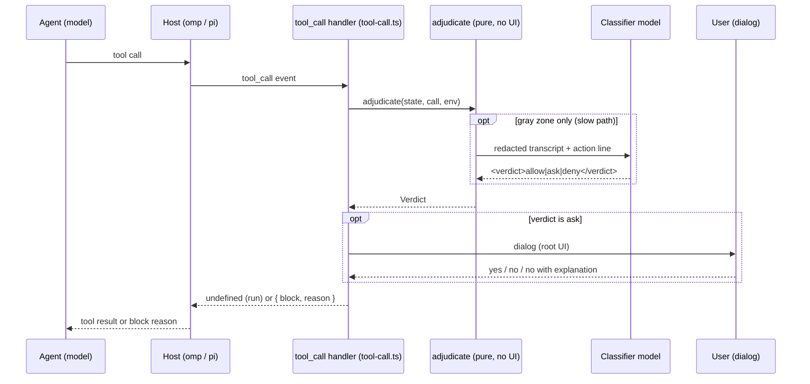
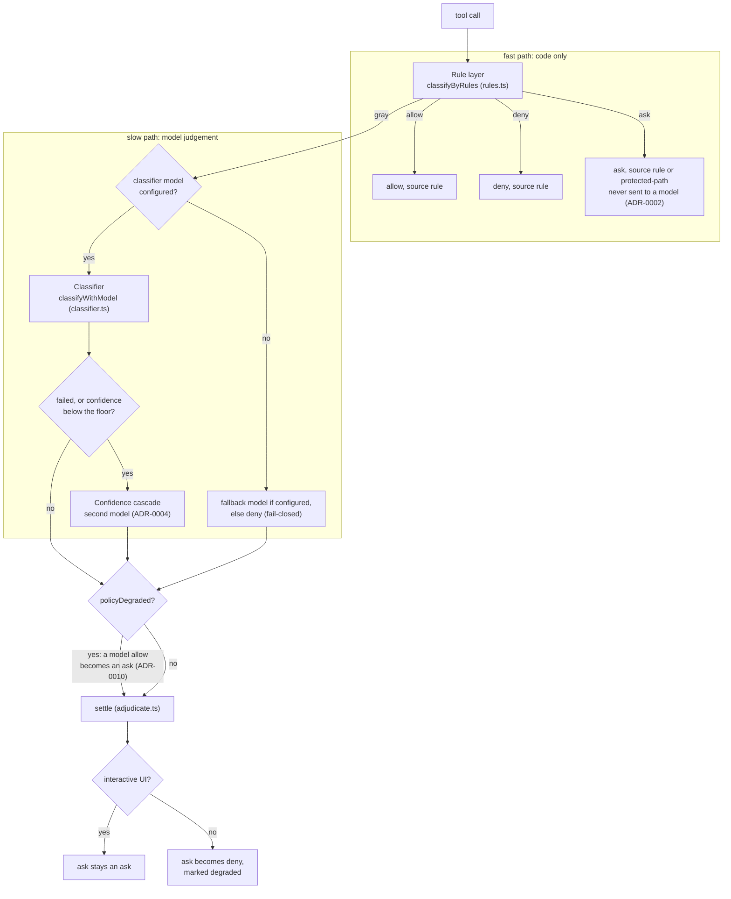
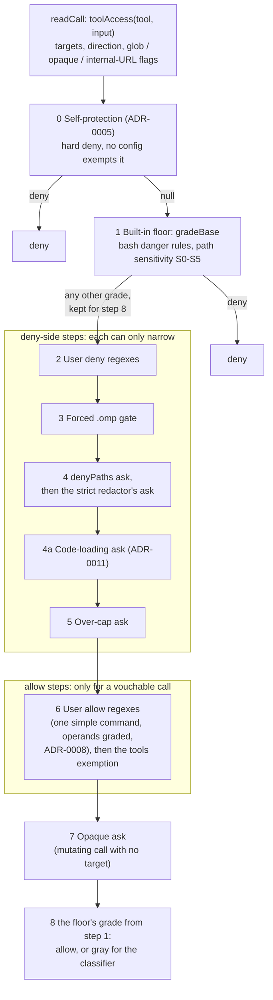
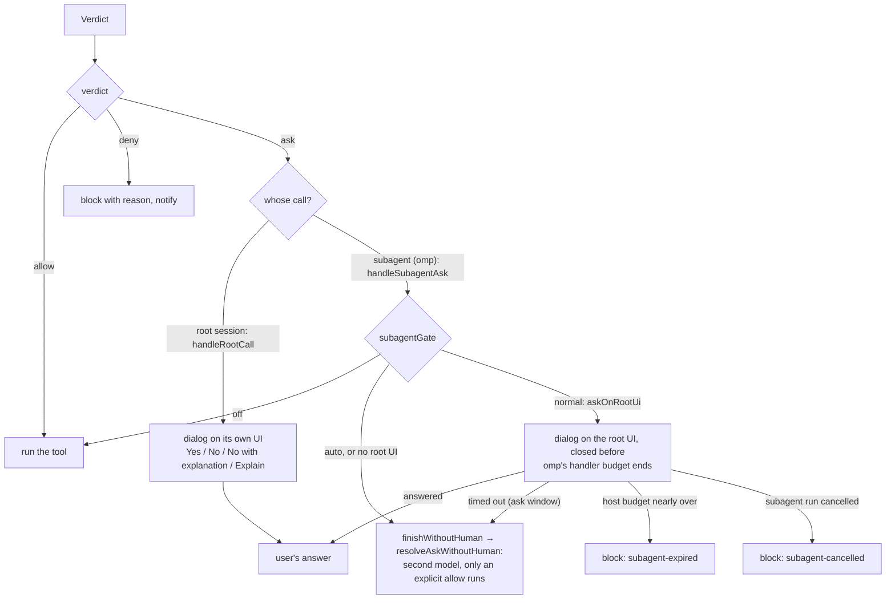
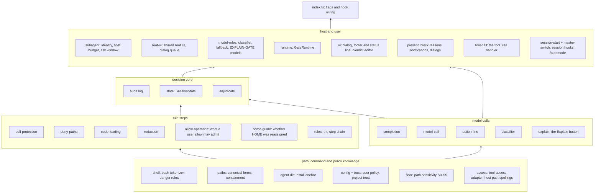

# Architecture

How pi-verdict decides a tool call: where it sits in the host, the order its checks run in, which modules own
which concern, and where the design is headed. The goals it serves are in [AGENTS.md](../AGENTS.md) ("Goals");
the exact layer contract the probe asserts is in [layers.md](layers.md), and the reasons behind each layer are in
[security-principles.md](security-principles.md) and the [ADRs](adr/README.md). Keep this document current when a
change moves a box or an arrow below.

## Where the gate sits

The host (omp or pi) emits a `tool_call` event before it runs any tool. pi-verdict's handler answers with nothing
(run the tool) or with a block and a reason (the agent sees the reason as the tool's error). Everything the gate
decides happens inside that one handler call, and the host waits for it.

The split between the handler and `adjudicate` is the main structural rule. `adjudicate` is pure decision code:
it gets everything host-specific through `AdjudicateEnv` (model lookup, completion, UI presence, host kind, the
session transcript), so tests and the probe drive it without a host. The host-facing modules own everything that
touches the user: the handler and the subagent bridge (`tool-call.ts`), presentation (`present.ts`), the footer
and the status widget, and the commands.

## The decision flow: fast path and slow path

Every call first goes through the rule layer, which is plain code: path grading, regexes over commands, set
lookups. When the rule layer decides, no model is called; that is the fast path. Only a call the rule layer
cannot decide, the gray zone, goes to the classifier model; that is the slow path.

The cutoff between the two paths is soundness. The rule layer may allow a call only when code can show the call
is harmless, and it may deny or ask only on a pattern it can match reliably. Today the fast path allows a file
read the path floor grades safe, a write inside the project, a user `allow` rule or `tools` entry, and an omp
`xd://` device call; it allows no bash command on its own (no built-in command allowlist), so every command that
the floor does not deny and no user rule covers takes the slow path. A user `allow` rule admits a command only
when the rule layer can grade every operand as a safe read. Widening the fast path to read-only commands is
planned (TODO item 6) and builds on that operand grading.

Every exit fails closed. A missing model, a timeout, an unparseable model reply or a failed config load ends in
deny or ask, never allow. One deadline (`ADJUDICATION_BUDGET_MS`, 27 s) covers the whole slow path, inside which
each classifier attempt has its own cap (`CLASSIFIER_TIMEOUT_MS`, 25 s) and time is held back for the second
model when one is configured (`FALLBACK_TIMEOUT_MS`, 15 s).

## The rule layer

`adjudicate` first works out the command cwd, the directory the call runs in (`resolveCommandCwd`): the session
cwd, or the `cwd` argument of omp's `bash`. It is `RuleContext.commandCwd`, so every step resolves the call's
relative paths from it, while `RuleContext.sessionCwd` stays the project a git allow must not leave. A `cwd` the
gate cannot resolve withholds the allow steps. `classifyByRules` reads the call once into a `RuleCall`
(`readCall`), then runs a chain of steps. Each step returns a result or `null` for "not mine", and the first
result wins. The order encodes "deny beats allow": every
deny-side step runs before any allow step. The numbers match the layer table in [layers.md](layers.md).

A call is "vouchable", so the allow steps may admit it, only when no target is a glob, an internal URL, a
relocatable read or opaque, and the user's policy loaded in full. The floor's allow is also turned gray for those
same target shapes (`withholdFloorAllow`), so a call the rules cannot read as a literal path reaches the
classifier instead of a silent allow.

A user `allow` regex admits a bash or powershell command only after two checks, both run after the regex
matches. `allowAdmits` (`shell.ts`) checks the shape: one simple command, no redirection, no re-parser and no
git write flag. `allowOperandsAdmit` (`allow-operands.ts`) checks what the operands touch: it expands `~` and
`$HOME`, expands a one-segment glob to the cwd entries it matches, refuses any other expansion, grades every
resulting path as a read through `classifyPath` with the floor on, refuses home-relative operands once the session
may have reassigned `HOME` (`RuleContext.homeReassigned`, read lazily from the session branch by `home-guard.ts`),
and refuses a `git` call whose global options it cannot read (`gitSubcommandIndex`), that injects configuration,
or that reads outside the cwd. A refusal only sends the call on to the classifier (ADR-0008 and its amendment).

### Known structural weakness

`readCall` reads the targets once, but it is not the only reader. Several steps read the raw input again in their
own way: self-protection, the `denyPaths` and `.omp` matchers, the strict redactor, the code-loading matcher and
the over-cap check each tokenize paths or command text themselves. Every such re-reading can disagree with the
others about what the call touches, and review rounds have repeatedly found path spellings that one step reads
and another misses. Host path spellings already go through one function (`hostPathForms`, ADR-0009), which closed
the largest class; the rest is TODO item 5, below.

## The slow path

The classifier sees a condensed, redacted transcript: the last few genuine user messages and tool calls, then the
action under review as the last line. Every model payload passes the wide redactor first, so a user-declared
protected path reaches a model only as a marker (ADR-0002). The model must answer with a
`<verdict>allow|ask|deny</verdict>` prefix; anything else fails closed.

The confidence cascade (ADR-0004) runs when the first model fails or, with the jev backend, reports a confidence
below `classifierMinConfidence`. A second model (`classifierFallbackModel`) then rules, in `enforce` mode, or is
only recorded, in `shadow` mode. It may never relax a demoted deny or ask straight to an allow: that case asks the
human.

## Presentation and the subagent bridge

`settle` turns the ruling into a `Verdict` (`allow | deny | ask`, with the deciding layer as `source`). After
adjudication the handler (`handleToolCall` in `tool-call.ts`) reads the call into a `PresentedCall`: the action
line, the form a notification may show, the UI the call's notifications and dialogs go to, the subagent label, and
the session redactor. That redactor is rebuilt after adjudication and kept wider than the one adjudication used, so
a `denyPaths` entry a `/verdict` edit added during the call is still redacted; Explain widens it again when the user
asks. `presentVerdict` (`present.ts`) is the single place that turns a verdict into user-visible text: a block
reason for the agent, a notification, or a dialog. The degraded-policy texts of those surfaces sit together in
`POLICY_DEGRADED` (`state.ts`).

An ask's audit record is appended exactly once, after the answer: with the user's answer, with the subagent
resolution, or without an answer when the presentation throws.

A subagent has no UI of its own, so its asks go to the root session's UI. `root-ui.ts` holds that UI and the
dialog queue at module level, the one place shared by every session in the process: the host builds one extension
instance per session, so everything else lives on that instance's `GateRuntime`. omp stops a subagent's handler
after `extensionHandlers.toolCallTimeoutMs` and does not pause that clock for a dialog on another UI, so the gate
reads the enforced value and closes the dialog first (`docs/host-contract.md`, `subagentAskWindow`). An ask that
ends without a human answer denies unless the second model explicitly allows it in enforce mode.

## Module map

Each arrow points from a group to the group that imports it; no module imports `index.ts`, which only registers
the flags and wires each host hook to the module that owns it. Leaves at the bottom:

Inside a group, modules also import each other in order (for example `floor` imports `shell`, and `rules` imports
the other rule steps). In the host group, `runtime` builds the `GateRuntime` that every later module takes: the
session state, the master switch, the debug flag and the host seams. `present` builds on `runtime`, `model-roles`
and the dialog, and `tool-call` builds on `present`. `index.ts` imports only the hook entry points.

`config` sits in the bottom group because `access` reads its tool-name lists from it, lists that belong with the
tool-access adapter itself.

`jev-adapter.ts` sits beside the gate as a second extension: it registers the jev classifier backend (ADR-0003),
and the gate imports only helpers from it.

## Where the design is headed

Two planned changes reshape this picture; both pass an independent architecture review before any code.

One shared reading of each call (TODO item 5) replaces the per-step re-reading above: a single function turns
the raw input into a typed description of what the call touches (paths in every form the host resolves, commands
as parsed words, code text), and every step consumes only that. Differential tests compare it with omp's own path
code over generated spellings. This is the fix for the recurring bypass findings, rather than one more spelling
rule per review.

A read-only command fast path (TODO item 6) then lets the rule layer allow inspection commands such as `ls` or
`git status` without a model call, behind the same deny-side steps and only for operands the floor grades safe.
The audit replay tool (TODO item 4) measures how many slow-path calls it absorbs before it is enabled.
