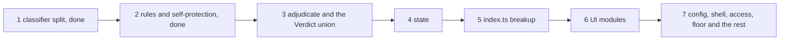

# Plan: simplify the gate's modules, then rewrite their comments

Status: in progress. Slices 1 and 2 landed on 2026-10-24 (after v0.20.0). This plan defines the finding ids
`C1`-`C41` that commits and the CHANGELOG may cite; code comments never do (`pv-comments`).

## Goal

The module split (v0.19.0) moved code mechanically, so each module still carries the structure and
the comments of the single 6,285-line file. This plan makes each module one concern with short
functions, then rewrites its comments to the `pv-comments` rules, one module at a time. Every slice
is behavior-neutral unless a finding says otherwise: probe output stays byte-identical, and the
full "Done" set in `pv-typescript.md` passes after each commit.

The findings come from three reviews: the tool-access round review (2026-10-05), and two
clean-code reviews of the split modules (2026-10-24). Line numbers drift, so each finding names its
symbol.

## Order

Simplify before rewriting comments, because extracting a helper removes some comments outright.
Each slice runs its comment pass (`C9`, `C28`) on the modules it touched before it closes.

| Slice | Findings |
| --- | --- |
| 1. Classifier split (done) | `C21`, `C27`, `C28` for the four model-call modules, plus `C26`'s `ModelChoice` |
| 2. `rules.ts` and `self-protection.ts` (done) | `C22`, `C30`, `C11` (`isWithin`), `C28` for both modules |
| 3. `adjudicate.ts` and the `Verdict` union | `C20`, `C25`, `C26`, `C37`, `C34` |
| 4. `state.ts` | `C32` |
| 5. `index.ts` breakup | `C18`, `C19`, `C23`, `C24`, `C33`, `C17` |
| 6. UI modules | `C29`, `C31` |
| 7. The other modules | `C1`-`C8`, `C11`-`C16`, `C35`, `C36`, `C38`-`C41` |

## Findings

### Done

- `C10` `OWN_FILE_PATH` placement is pinned by a test (v0.19.0).
- `C21` `classifier.ts` split into `action-line`, `redaction`, `completion`, `model-call` and
  `classifier`; the deterministic rule layer no longer imports the model-call code; `collectStrings`
  moved to `access.ts`; the temperature policy lives in `model-call.ts`.
- `C27` the redactor is a required argument of every model payload, pinned by a test that fails when
  any call site drops it.
- The `/verdict` menu's wrong `gateOmpDir` default label (part of `C24`) was fixed in v0.19.0, and
  the invisible characters in `stripZeroWidth` are spelled as escapes.
- `C22` `classifyByRules` takes a `RuleContext` and reads as one chain of named layer steps;
  `gradeBase` grades the floor, `canVouch` gates both allow layers, and `commandText` replaces the
  command coercion in every module.
- `C30` `buildProtectedSet` builds through `installRootFamilies`, `installTargets`, `pluginRoots`
  and `enablementFiles`; `selfProtectCheck` builds its denies through `selfDeny`.
- `C11`, the `isWithin` part: one containment helper in `paths.ts`, correct for the filesystem root
  and case-folded on macOS and Windows, used by `deny-paths.ts` and `self-protection.ts`. It fixed a
  `denyPaths` miss for a search of `/`, and self-protection's directory checks now fold case on
  macOS and Windows. The other containment copies (`samePath`, `redaction.ts`, `floor.ts`,
  `code-loading.ts`'s `strictlyUnder`) stay open for their slices.
- `C28` for `rules.ts` and `self-protection.ts`.

### Open

- **C1 `loadUserRules` (`config.ts`, about 240 lines, nesting 7).** Eight jobs in one function:
  first-run template write, parse, unknown-key warning, single-string coercion, project
  trust and merge, per-key validation, degraded bookkeeping, assembly. Repeated idioms: the
  fail-closed return literal (3), trim-or-null (5), a trimmed non-empty string list (3), the
  string-array guard (4). Fix: a `Diagnostics` accumulator; `readUserConfigFile`,
  `mergeTrustedProject`, `validateRules`, `failClosedLoad`; helpers `trimmedOrNull`, `stringList`;
  move the template write out of the loader; name the `60_000` subagent timeout constant.
- **C2 Six hand-synced key lists (`config.ts`).** `UserRules`, `EMPTY_RULES`, `KNOWN_USER_KEYS`, the
  inline raw type, the return literal and `USER_CONFIG_TEMPLATE` repeat each key and its default.
  Fix: one key table `{key, default, parse}` that derives the others.
- **C3 `access.ts` (789 lines) holds four concerns:** host path spelling, the tool-access adapter,
  session-start diagnostics (`toolCoverageReport`, `sideEffectingToolsWarning`) and hashline and
  patch-header parsing. Tool-name policy is spread over seven sets and predicates. Fix:
  `tool-names.ts` (one traits table), `host-path.ts`, `hashline.ts`, `session-warnings.ts`.
- **C4 Flat bags where `pv-typescript` asks for discriminated unions:** `RuleResult`, `ToolAccess`,
  `kernelWalk`'s result, `BashDangerRule` (a non-null assertion). Export the types that exported
  functions return (`ToolAccess`, `TrustStore`, `LoadedRules`, `HostPathFormOptions`).
- **C5 Credential directories are held twice (`floor.ts`):** the S0 regexes and the plain
  `S0_HOME_DIRECTORIES` list can drift. The three-way S0 test is copied in `classifyPath` and
  `globStaysInProject`. Fix: one table and a `hitsS0(forms)` helper.
- **C6 `shellWords` (about 120 lines) and `gitPushInWords`:** a duplicated line-continuation block,
  the shell option list written twice. Fix: per-construct scanners, `continuationLength`,
  `scanShellOptions`.
- **C7 `shell.ts` holds five concerns:** tokenizer, force-push analyzer, danger rules and
  `classifyBash`, `allowAdmits`, Python cell extraction. Move `RuleResult` and `BASH_MAX_MATCH_LEN`
  to a shared types module.
- **C8 Orphaned doc comments from the carve:** above `escapeRegExp` (`agent-dir.ts`) and
  `S0_HOME_DIRECTORIES` (`floor.ts`); the `classifyPath` doc is garbled.
- **C9 Plan and review ids and narrated history** in `shell`, `paths`, `agent-dir`, `trust`,
  `config`, `floor` and `access` (about 70 lines): the `pyEvalShellLines` and `kernelWalk` docs, the
  `DEFAULT_ALLOWED_TOOLS` essay, "research report" citations. Rewrite per `pv-comments`.
- **C11 Duplicated path knowledge:** three tilde expansions that disagree on `~name`; the
  remaining containment checks (`samePath`, inline `startsWith(b + sep)` in `floor.ts` and
  `redaction.ts`, `strictlyUnder` in `code-loading.ts`), which should use `isWithin`, and
  self-protection's `exact` files and `writePatterns`, which still compare case-sensitively on
  macOS and Windows while its directories fold case; the
  project-config stop rule written three times; "parse JSON, require an object" in three places.
  Fix: `expandTilde`, `lexicalAndRealForms` in `paths.ts`; `projectLayout`; `readJsonObject`.
- **C12 Module-level mutable state and test setters in `floor.ts`** (`anchoredS0`, `agentDbRule`,
  `tmpdirExemptBases`, the `set…ForTests` functions). Fix: a `FloorContext` built once and injected.
- **C13 Boolean flag parameters** (`classifyPath(t, cwd, true, floorOn)`, `redactorFor(…, true)`,
  `hostPathForms` with four booleans). Use modes or named options.
- **C14 Long or tangled functions:** `toolAccess`, `kernelWalk` (magic `4096`, a dead guard),
  `peelHostSelector`, `hostPathForms`; `userRuleTargets` coerces a non-string command.
- **C15 `trust.ts`:** UI labels beside persistence; `recordTrust` returns `null` for success;
  `TrustStore` should be a result union.
- **C16 `config.ts`:** toggle-shortcut validation is its own concern; the coverage and
  side-effecting tool lists belong with access; the `_hint` is one 3,600-character line.
- **C17 `index.ts` header:** a stale "PROTOTYPE" header that duplicates `AGENTS.md`, test-only
  re-exports, and pure helpers that belong in `paths.ts`.
- **C18 `autoMode` is an 878-line closure holding eight jobs** sharing about ten closure variables.
  Fix, each step green: move the `/verdict` editor to `ui/config-editor.ts`; extract
  `model-roles.ts` (`C23`); extract `present.ts`; extract `tool-call.ts` (`C19`); extract
  `session-start.ts` and `root-ui.ts`; pass one explicit `GateRuntime` object. `index.ts` ends as
  about 120 lines of wiring.
- **C19 The `tool_call` handler mixes six jobs** and handles `"aborted"` three ways; the block type
  is written four times. Fix: `GateBlock`, `buildEnv`, `withStatusWidget`, `handleRootCall`,
  `handleSubagentCall`, `finishWithoutHuman`; `finalize` returns a new record.
- **C20 `adjudicate` writes its settle tail three times** (headless degradation, `autoDeny:false`,
  the pending audit record), with opaque `eff*`/`fc*` names, a docblock orphaned above
  `AUTO_DENY_OFF_SUFFIX`, and `blockedReason` beside a closure `blockReason`. Fix: one `settleAsk`,
  `adjudicateRuleAsk`, `adjudicateWithoutModel`, `adjudicateGrayZone`, an `autoResolveFor` in place
  of the four-deep ternary; `buildRecord` as a module function.
- **C23 Model-role resolution is copied four times** with five warn-once latches outside
  `SessionState.reset()`; the classifier shares one latch between two warnings. Fix:
  `model-roles.ts` with `resolveModelRole`, latches registered in `reset()`, `THINKING_LEVELS` as a
  const tuple with a type guard.
- **C24 The `/verdict` editor lives in the extension body** (about 240 lines, six nested functions,
  nesting 7). Fix: move it to `ui/config-editor.ts`; drive the scalar keys from one table whose
  defaults come from `EMPTY_RULES`.
- **C25 `Verdict` is a flat bag.** Fix: `Allow | Deny | Ask`, one `switch` in `presentVerdict`
  ending in `never`, a `BLOCK_TAG` table, one mapping between the four source vocabularies, an
  immutable audit record.
- **C26 Positional-parameter lists:** `classifyWithModel` 11, `callModelOnce` 9,
  `runConfidenceCascade` 8. Fix: an `interface ModelCall` built once per adjudication.
- **C28 Plan ids and history in the remaining modules:** `adjudicate.ts` (`item 6b`, `item 7`,
  `#67`/`#71` prose), `index.ts`, `state.ts`, `deny-paths.ts`
  (the 23-line `bashPathTokens` derivation), `footer.ts`, `audit.ts`, `explain.ts`.
- **C29 Wrong-home helpers:** `subagent.ts` mixes the subagent bridge with dialog helpers;
  `resolveAskWithoutHuman` lives in `adjudicate.ts`; `declineDetail` in `explain.ts`.
- **C31 `ui/dialog.ts` holds five concerns,** including the security-relevant `displaySafe`;
  `fencedBlock` uses bare sizes tied implicitly to the caps; two `as` casts lack a why-safe comment.
- **C32 `SessionState`'s constructor** loads the config from disk even when rules are passed;
  `agentDir: null` has two meanings; `verdictCounts` is mutated from outside.
- **C33 The "redact or show" idiom is written seven times,** and the session redactor is rebuilt per
  call in three places. Fix: `redactedOr(redact, input, text)`, one redactor per call.
- **C34 A provider that returns on abort is retried after its timeout.** jev returns
  `stopReason: "aborted"`, so the attempt reads as `ok` and timed out, and the retry check misses
  it. The deadline still bounds it. Fix: stop on a timed-out attempt unless a parseable verdict
  arrived.
- **C35 The content excerpt follows a newline,** so the transcript's last line is model-written
  content, while both system prompts treat the last line as the action. Fix: keep the excerpt on
  the action line after a separator.
- **C36 Redaction runs over the whole session branch on every gray call,** before the transcript
  keeps its last tool calls. Fix: slice to the kept tool calls first.
- **C37 The degraded-policy rule is implemented four times** (`resolveAskWithoutHuman`, both
  `adjudicate` branches, two checks in `classifyByRules`), and its wording lives in five places.
- **C38 `action-line.ts` holds two concerns:** text cleaning beside action-line rendering;
  `toolCallLine` and `actionCallLine` both derive targets and format the multi-target suffix (a
  near copy sits in `access.ts`). Fix: a text-cleaning module, `accessTargets`, `lineSafe`.
- **C39 `actionCallLine` resolves written content in a triple-nested ternary;** the `0.6` head ratio is
  unnamed, and two 2000-character constants have two names.
- **C40 The `classifyWithModel` loop** builds its attempt label four times, uses terse names
  (`r`, `fire`), builds `diag` eagerly, and carries story comments.
- **C41 `redactorFor` (54 lines)** builds the spelling set and the matcher together; its doc lists
  spellings instead of stating a predicate; `toolAccess("", args)` passes a magic empty tool name.
