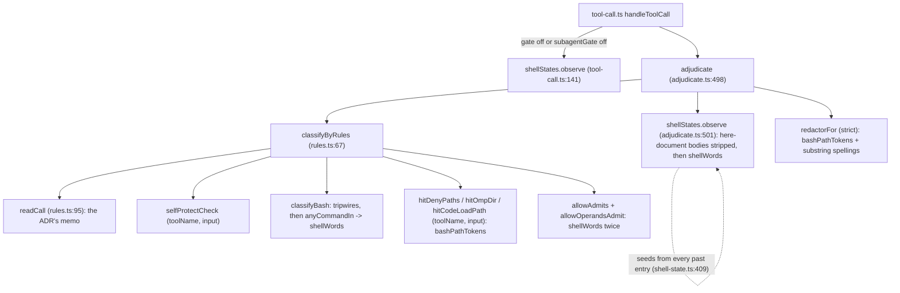

# ADR-0012 review: soundness and risk

Review of `docs/adr/0012-shared-shell-reading.md` (status `proposed`, untracked on `main` at `e5f8709`), read on 2026-11-02
against the code on that commit. The lens is soundness and risk: whether the proposed `ShellReading` can carry a `sound`
status that the floor and the allow layer may trust, whether the migration really never grades a call less strictly than
today, how the design fails, and what else it touches. A sibling review covers necessity and cost
(`research/2026-11-02-adr-0012-review-*.md`).

Citations are `path:line` in this repository at `e5f8709`, unless they name the omp source clone
(`.scratch/research/oh-my-pi`, `packages/coding-agent` 18.13.0) or the pi package in `node_modules`.

## Verdict

Approve with changes (`NEEDS_REVISION`). The shape is right: one typed reading per call, raw-text nets kept on purpose,
and a parse status that gates every clearing and every admission. As written, though, the ADR does not keep its own
promise that no layer grades less than today. Its `sound` status would be wider than today's, and its cap table merges
caps that fail in different directions. Step 2 calls a reader swap "no behaviour change" without a way to prove it. Each of
these is a text change to the ADR before any code, not a change of direction.

## How the readings reach the layers today

The ADR assumes every consumer can take the reading from `readCall` in `rules.ts`. One consumer cannot: the session
shell-state record reads the call before `classifyByRules` runs, and also on calls the gate does not adjudicate.

## Findings

Ranked by impact. Each finding gives the failure, the condition that triggers it, the evidence, and a fix.

### F1 (Critical): the new `sound` is wider than today's, so step 2 clears floor denies

Today `shellWords` marks every `<<` as unsound, here-strings included (`extensions/pi-verdict/shell-words.ts:169-173`),
and stops at `$'…'` (`shell-words.ts:99-103`). Every floor rule therefore keeps its deny on any command with a
here-document, a here-string or an ANSI-C quote. The ADR's reader keeps here-document bodies "as data" and marks a
call `partial` only for "a here-document fed to a shell" (ADR-0012 lines 66-71), and it lists `ansi-c` as an ordinary
expansion kind (line 62). That makes these calls `sound`, and a sound reading may clear a tripwire hit.

Three concrete calls move from deny to the classifier at step 2, which the ADR labels "No behaviour change":

- `bash <<< 'git reset --hard'`. Bash reads its commands from standard input. The here-string word becomes a redirect
  target, which the word view never checks (redirect targets are dropped from the words today, `shell-words.ts:66-70`),
  and `bash` has no `-c` script (`shellScriptAt`, `shell-words.ts:426-441`). Nothing hits, so the tripwire hit clears.
  Whether a here-string counts as "a here-document fed to a shell" is not said.
- `python3 - <<'EOF'` with a body that calls `os.system("git reset --hard")`, or `ssh host <<EOF`. The consumer is not a
  shell, so the ADR's rule makes the reading `sound`, but the consumer runs the body.
- `cat <<EOF` with `$(git reset --hard)` in the body. With an unquoted delimiter, bash applies parameter expansion,
  command substitution and arithmetic expansion to every body line, so the substitution runs whatever reads the body.
  The `Redirect` type carries no field for whether the delimiter was quoted.

The root cause is that `partial` is defined as a denylist of constructs ("fed to a shell"), while the floor's inert
positions are an allowlist (ADR-0007 amendment, `shell-words.ts:500-527`). A program that runs its input is unbounded.

Fix. State an invariant in section 3: during the migration, a reading is `sound` only where `shellWords` emits no
unsound mark today, and any widening of `sound` is its own visible step with probe cases. For here-documents and
here-strings, either keep them `partial`, or define the body as a word in the position of the command it feeds, so the
floor's `mentions` check sees it and only a known inert consumer with no output that may run can clear it. Add
`expands: boolean` (unquoted delimiter) to `Redirect`, and fold a body's expansions into the reading's status. Keep
`$'…'` `partial` until a decoder has its own differential tests.

### F2 (Critical): the migration has no way to prove "no behaviour change", and its guard misses the allow direction

Step 2 swaps four consumers onto a new reader at once (the floor's word view, `allowAdmits`, the allow operands and
the shell state) and claims no behaviour change (ADR-0012 lines 134-135). The probe's 193 cases (`probe/cases.ts`)
assert exact layers, so they catch a change only on inputs they already hold. The new probe check "fails when any
verdict moves from deny or ask toward allow" (line 131) leaves out the move that matters most for the allow layer:
gray to a rule allow, which skips the model entirely (`docs/layers.md:66-69`). It also leaves out deny to ask, which is
toward allow (F3).

`TODO.md` item 4 names the audit replay tool "the safety net for item 9", the shared reading (`TODO.md:19`), but the ADR
does not use it.

Fix. Before step 2, add a differential harness that runs the current `classifyByRules` and the migrated one over one
corpus: the probe inputs, every command string in `tests/`, the seeded fuzz generator's output, and the item 4 replay
once it exists. It fails on any move in the order deny, ask, gray, allow, toward allow. Split step 2 into one consumer per
slice, each gated by that harness. Also add a unit-level differential test in step 1: a legacy view of the reading
must equal `shellWords(text)` on the same corpus, so every intended difference is listed instead of discovered.

### F3 (Important): one cap table with "one typed result" merges caps that fail in different directions

Section 5 sends every breach on the current call to the over-cap ask (ADR-0012 lines 97-100). Today the caps fail
differently, and two of them fail more strictly than an ask:

- The `sh -c` recursion depth: past `SHELL_RECURSION_DEPTH` the word view returns a hit, so the floor's deny stands
  (`shell-words.ts:596`). An ask instead is deny to ask, and in an interactive session a human click then runs it.
- The command length: the floor still reads the first `BASH_MAX_MATCH_LEN` characters and denies on a dangerous prefix
  (`shell.ts:394-397`); the over-cap ask comes later, after the deny-side layers (`rules.ts:82`, `docs/layers.md:20`).
  If the typed breach short-circuits before the floor, a dangerous prefix asks instead of denying.
- The operand cap: a breach refuses the allow and the call reaches the classifier (`allow-operands.ts:112`). An ask
  instead adds a needless ask, which the Goals in `AGENTS.md` call a defect.

The cap also has three aliases the ADR does not list: `ACTION_LINE_MAX_CHARS` (`action-line.ts:56`) and
`HOST_PATH_FORMS_MAX_CHARS` (`access.ts:97`) both equal `BASH_MAX_MATCH_LEN`, and `docs/configuration.md:59` documents
that the over-cap horizon is aligned with the floor's reading horizon, so that no allow admits an unread tail. That
alignment is a security invariant. `BASH_MAX_MATCH_LEN` is also exported (`index.ts:35`).

Fix. Give each `LIMITS` entry its own breach outcome, equal to today's: depth counts as a hit, length keeps the
floor's prefix read and then the over-cap ask, operands refuse the allow, and the shell-state length takes the
substring scan. Keep one value for the floor horizon and the action-line cap, and pin it with a test. Keep the
exported name.

### F4 (Important): constructs the model cannot read would still be called `sound`

The model has words, redirects, an `end` operator and a `grouped` flag (ADR-0012 lines 45-63). It has no notion of a
`${…}` span, an arithmetic or conditional command, or a reserved word, yet section 1 promises `sound` "when every
construct was read faithfully". These are cases where bash reads the text differently from that model:

- `: ${x:- #} ; git reset --hard`. Bash reads `${x:- #}` as one word, so `git reset --hard` runs; a scanner that
  starts a comment at a word-initial `#` drops it. ADR-0007 accepts this as a residual (`docs/adr/0007-monotone-floor.md:96-97`).
  Section 6 then pins each residual's route with a probe case, which would enshrine a reading that is wrong but called
  `sound`. More generally, `${…}` may hold blanks, `;`, quotes and `}` escapes without ending the word.
- `[[ … ]]` reads `<`, `>`, `&&` and `||` as test operators, not as redirections or list operators. `(( … ))` and
  `$(( … ))` are arithmetic, where `#` is no comment, and `$((` must be told from `$( (`.
- `case` patterns end at `)`, and `;;`, `;&` and `;;&` end a case item. The `end` union has none of the three
  (ADR-0012 line 54), though `;;` is an operator today (`shell-words.ts:27`).
- `x=( … )` is an array assignment, not a subshell. With `extglob` on, `!( … )` and `@( … )` are one word; the agent's
  shell replays the user's `shopt` settings (`allow-operands.ts:209-212`).

Most of these over-report commands, which is the safe direction for the floor. The `${…}` and comment cases
under-report, which is not.

Fix. Define `sound` as "inside the modelled subset", and list the subset. Mark `partial` on any `${` whose span holds a
blank, `#`, `;`, a quote or an escaped `}`; on `[[`, `((`, `$((` and `case`; and on `(` directly after `=`. Pin the
`${x:- #}` residual as "now denies" rather than "still reaches the classifier".

### F5 (Important): section 4's wording would weaken two floor fallbacks and invites a quoting mistake

Section 4 says a non-literal word in a position whose meaning matters "sends the call to the classifier" (ADR-0012
lines 91-92). For the allow layer that is right. For the floor, the right outcome is to keep the tripwire's hit, as
`gitRunsIn` does today when it cannot read git's options: `git $X stash clear` denies because a later word names the
subcommand (`shell-words.ts:331-334`, `shell.ts:80-82`). Read literally, section 4 would turn that deny into a classifier
call. It also would not fix `git push$NOPE origin +main`, which already clears to the classifier (`TODO.md:18`), when the
right fix is a deny.

The same section says a layer asks `quoted` "before treating a word as an inert argument" (line 91). Quoting never makes
a word inert to the program that receives it: `git log '--output=/tmp/x'` still writes a file, and `'rm' -rf x` still
runs `rm`. ADR-0007's inert positions are decided by the program, not by quoting.

Fix. Split the rule by layer: in the floor, a non-literal word where meaning matters keeps the hit; in the allow layer,
it refuses the admission. State that `quoted` only means "no expansion", and that `literal` is the only predicate any
admission or clearing may rely on; the `expansions` set is diagnostic, so a kind added later cannot slip past a
consumer that checks for specific kinds.

### F6 (Important): the session shell state cannot take its reading from `readCall`

The shell-state record is updated in `adjudicate` before `classifyByRules` builds its call record
(`adjudicate.ts:501`, `rules.ts:68`). It also runs on calls the gate lets through ungated (`tool-call.ts:139-148`), and
it seeds from every past entry of the session (`shell-state.ts:407-423`). It reads a different text: here-document
bodies are stripped first, and a body whose delimiter never comes is kept (`shell-state.ts:238-276`, ADR-0008 lines
220-224). So section 2's "every consumer takes the reading from there" is not true for this consumer, and the ADR is
silent on which text it reads.

There is a failure-mode consequence too. A reader exception thrown on the ungated path blocks a call while the user has
switched the gate off, because `observeUngated` has no `try` around it (`tool-call.ts:140-143`). On omp a throwing
handler becomes a block whose reason names the extension and the error message
(`.scratch/research/oh-my-pi/packages/coding-agent/src/extensibility/extensions/runner.ts:1963-1977`); on pi,
`beforeToolCall` rethrows (`node_modules/@earendil-works/pi-coding-agent/dist/core/agent-session.js:227-240`). Both hosts
fail closed, which is correct for an adjudicated call and an outage for an ungated one.

Fix. Build the reading once in `adjudicate`, or in `handleToolCall` for the ungated path, and pass it both to `observe`
and to `classifyByRules`. Have the reader own here-document recognition, so shell-state no longer strips bodies by its
own regex (`shell-state.ts:230`), and state that an unterminated body is read as commands. In `observe`, catch a reader
exception and record the fail-closed state (every allow voided) rather than throwing.

### F7 (Important): step 5 breaks the invariant that redaction covers every `denyPaths` spelling

`redactorFor` states that "every spelling the `denyPaths` layer catches redacts here", because both tokenize the
command with `bashPathTokens` (`redaction.ts:70-71`, `redaction.ts:86`). Step 5 widens `denyPaths` with the reading's
targets, but the migration does not list redaction, and the ADR's diagram leaves it out. A spelling that only the
reading resolves, such as `cat ~/'.ss'h/id_rsa`, would then ask, while the transcript of later calls still shows the
command in plaintext to the classifier (ADR-0002). The strict redactor is also the `protectedSpellingAsk` layer
(`rules.ts:210-217`), so the two asks would drift apart again, which is the divergence the ADR sets out to end.

Fix. Move redaction in the same step as `denyPaths`, with a test that every `denyPaths` command hit is also a redactor
hit. Bound the cost: the redactor reads past calls, so memoize readings by text for the duration of one transcript build.

### F8 (Important): the ADR does not say what a `powershell` call gets

`isCommandTool` covers `bash` and `powershell` (`access.ts:356-358`), so a PowerShell command goes through the bash floor
(`rules.ts:121`), and its tripwire hits are cleared by a reading with bash quoting. The ADR says the reader "does not
read PowerShell" (line 68) but not what status such a call receives. Today, `echo "a\" ; git reset --hard ; \""` reads
in bash as one `echo` argument, which is inert, so the hit clears; PowerShell does not treat `\` as an escape, so its
string ends early and `git reset --hard` runs (PowerShell semantics from its language documentation, not tested here).
The allow layer already refuses a PowerShell backslash (`allow-operands.ts:97-98`), so the result is a classifier call,
not an allow, and it is Windows-only. The gap predates this ADR, but section 1 is where it should be decided.

Fix. Give a `powershell` call the status `unreadable`, so its floor runs on the tripwires alone and no word view clears
a hit. Decide separately whether PowerShell allows keep their current bash-shaped admission, since `unreadable` would
send every one of them to the classifier; that is a usability trade-off for the user.

### F9 (Suggested): the union's target set is undefined, which can add needless asks

Step 5 unions the reading's targets into `denyPaths`, code-loading and self-protection, but does not say which words
are targets. `bashPathTokens` yields only path-shaped tokens (`deny-paths.ts:32`). If every literal argument counts,
`ls .pi` and `rg foo .omp` start to ask through the code-loading layer, which treats a command's targets as written
because its direction is unknown (`code-loading.ts:303`, `deny-paths.ts:168-171`). That is a needless ask on a read.
Code-loading also reads an expanded copy of the command (`code-loading.ts:276-282`), so the reading's targets would
need the same `$PWD` and `$PI_CODING_AGENT_DIR` expansion. Self-protection is a hard deny that no configuration lifts
(`docs/layers.md:14`), so a false target there has no escape.

Fix. Define a reading target as a literal word that is path-shaped by the `bashPathTokens` grammar, or that is the
operand of a known file-taking position (`cd`, `pushd`, a redirect target). Apply the code-loading expansion to the
reading's words too. Add a probe case that `ls .pi` and `rg foo .omp` keep their current layer.

### F10 (Suggested): the reference shell is not named, and nothing tests fidelity against a real shell

omp's `bash` tool runs commands in the embedded brush-core shell
(`.scratch/research/oh-my-pi/packages/coding-agent/src/exec/bash-executor.ts:4`), with the user's rc snapshot replayed
into it, aliases included (`src/utils/shell-snapshot.ts:32-46`). pi runs a real shell. The ADR measures `sound` against
bash alone. Section 6's fuzz invariant ("no word holding an unquoted `$` … is `literal`") checks the reader against
itself, not against a shell.

Fix. Name bash as the reference and record brush differences as residuals. Add a dev-only differential test against
bash's own parser that runs no command: wrap each corpus command in a function body and compare `bash -n` and
`declare -f` output with the reading's command boundaries. State that `sound` is syntactic only; it says nothing about
what an alias, a function from the snapshot, or a variable's run-time value does.

### F11 (Suggested): the model leaves command position to each consumer

`SimpleCommand.name` is the first word after the assignments (ADR-0012 line 51), so in `if git reset --hard`,
`time git …`, `! git …`, `{ git …; }`, `coproc git …` or `env -i git …`, the name is not `git`. Today the floor scans
every word position (`gitRunsIn`, `shell-words.ts:329-330`), and shell-state has its own prefix-word and wrapper sets
(`shell-state.ts:97-100`). If consumers move to `name`, the floor loses coverage; if they keep their own wrapper logic,
the divergence the ADR targets stays.

Fix. Put reserved-word skipping and wrapper peeling into the reading (an `effectiveName` index plus the wrapper chain),
and state that the floor's matchers keep scanning every word position as their net.

### F12 (Suggested): order and lifetime details that will cause rework

- Step 6, the residual probe cases, comes after the risky steps. Move it to the front, so steps 2 to 5 run against
  pinned residual routes.
- Section 2 keeps the memo on the call record, while the diagram says "memoized per text". State that the memo lives for
  one call (plus one transcript build, F7), so no reading outlives the call and memory stays bounded.
- `allowAdmits` keeps raw-text checks for redirections and for `&>`, which POSIX `sh` reads as a background `&`
  (`shell.ts:330-335`). Section 3's list of nets omits them; list them so a port does not drop them as redundant.
- `outputMayRun` withholds inert positions whenever a `(` or `)` word appears (`shell-words.ts:550-553`). The new model
  has no such words; say whether a subshell group still withholds them, or the port may clear more.
- `shellWords` is exported (`index.ts:36`) and returns an internal sentinel string; only `tests/pi-verdict.test.ts`
  (5 calls) and no probe or tool use it, and agent-setup's harness imports only `adjudicate` and `SessionState`
  (`~/src/agent-setup/src/tools/omp-gate-check/probe.ts:11`). Decide whether to keep it exported before writing the
  "thin view", and list the change in the release's exported-API diff (`AGENTS.md`, "Release").
- The hit functions take `(toolName, input, cwd)` (`rules.ts:184`, `rules.ts:198`, `rules.ts:224`, `rules.ts:69`), so
  each needs a new parameter for the reading; name that signature change in step 5.
- Section 4 claims to close TODO item 3's expansion gaps, but a `-c alias.x=push` alias is git semantics, not shell
  expansion. Say which item 3 gaps the step closes.

## What is already right

Keep these through the revision. The raw-text nets stay, so a reader bug can only cost a clearing, never a deny the
tripwire found; that is ADR-0007's monotone rule applied consistently. A non-`sound` reading maps to today's unsound
mark, so neither the floor nor the allow layer gains any new way to clear or admit on a reading it could not finish.
Per-word provenance is the right fix for the brace, `$NOPE` and process-substitution gaps, which all come from
`shellWords` returning plain strings. Rejecting a full parser as a WebAssembly dependency keeps the zero-dependency
rule and loses little, since no parser resolves run-time values. Work-count tests instead of wall-clock bounds match
`pv-tests.md`. Both hosts block a call when the handler throws, so a reader exception on an adjudicated call fails
closed without extra code.

## Implementation brief

A dependency-ordered list for the session that revises the ADR and then builds it. Each step lands on its own.

1. Revise the ADR text: the `sound` subset and invariant (F1, F4), per-layer non-literal outcome and the meaning of
   `quoted` (F5), per-cap breach outcomes (F3), the PowerShell status (F8), the reference shell (F10), the target
   definition (F9), and the build point for the reading in `adjudicate` (F6).
2. Add the residual probe cases first, including `bash <<< …`, `python3 - <<'EOF'`, an unquoted-delimiter body with
   `$( … )`, `${x:- #}`, `git $X stash clear`, `git push$NOPE origin +main`, `ls .pi`, and one depth-cap case.
3. Build the differential harness: current versus migrated `classifyByRules` over probe inputs, test commands and the
   fuzz corpus, failing on any move toward allow in the order deny, ask, gray, allow (F2).
4. Add `shell-reading.ts` with no consumer, its legacy-view equality test against `shellWords`, the bash differential
   test, the fuzz and work-count tests.
5. Move consumers one per slice, each gated by step 3: the shell state (built in `adjudicate`, with the ungated path
   catching reader errors), then the allow operands, then `allowAdmits` (raw nets kept), then the floor word view.
6. Move the caps into `LIMITS` with their current outcomes and one shared floor and action-line horizon.
7. Close the expansion gaps through `literal`, as visible changes with CHANGELOG entries.
8. Union the reading's targets into `denyPaths`, the `.omp` gate, code-loading and self-protection, with redaction in
   the same step and its coverage test (F7, F9).
9. Send agent-setup a pin note listing the verdict changes from steps 7 and 8 for its gate-check suite.

## Unverified

- The PowerShell reading of `echo "a\" ; git reset --hard ; \""` comes from PowerShell's documented quoting rules; it
  was not run.
- How brush-core parses here-strings, `${…}` spans, `[[ ]]` and comments was not checked against its source in the clone.
- Whether omp ships a `powershell` tool on Linux was not checked; the gate's handling is the same either way.
- How pi presents a rethrown handler error to the agent was read from `agent-session.js` only up to the rethrow.
