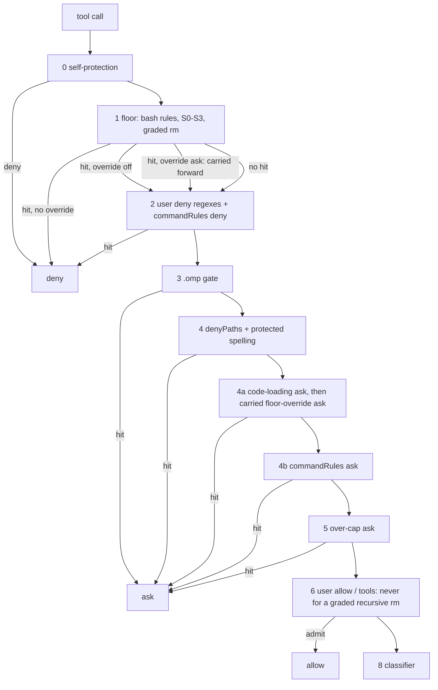

# ADR-0013 review: configurable command rules, floor overrides, secret signatures and graded deletes

Independent architecture review of `docs/adr/0013-configurable-rules.md` (status `proposed`, added in `4d3c3c9`), read on
2026-11-02 against the code at `4803900`. The review takes the direction in `TODO.md` item 9 as settled (command rules
may deny or ask, one built-in rule may be switched off or softened, the secret signatures grow and gain exemptions,
recursive deletes are graded by target) and judges only whether the record realizes it soundly. It also takes as given
the user's answers to the three open questions, recorded in `TODO.md` at `4803900`.

Citations are `path:line` in this repository at `4803900`, `ADR-0013:<line>` for the record under review, the omp source
clone (`.scratch/research/oh-my-pi`, `packages/coding-agent` 18.13.0), or the cc-safety-net clone
(`.scratch/research/cc-safety-net`, 2.7.1). The TypeScript language server could not start in this checkout (the
workspace's TypeScript 7.0.2 ships no `tsserver.js`), so symbol uses were found by text search with `rg`.

## Verdict

`NEEDS_REVISION`. The four decisions are the right shape for the goals: overrides are user-only and scoped, the
catastrophic deletes stay exempt, a graded delete never becomes a rule allow, and errors set `policyDegraded`. As
written, though, one rule makes every heredoc-style `git commit` a hard deny under the user's own rulebook, a softened
floor rule can pre-empt the user's deny rules and leak a declared path to a model, and several scopes are keyed on
values the agent controls. Every finding is a change to the record's text before any code, not a change of direction.

## Where the changes sit, and where they should

The record's diagram (ADR-0013:135-159) returns an override's ask from layer 1, before every deny-side layer. The code
today returns only a floor deny early and carries every other floor grade to the end (`extensions/pi-verdict/rules.ts:72-89`).
The corrected flow below keeps that discipline: a softened floor rule asks only after the user's deny rules and both
protected-path asks have had their turn.

## Findings

Ranked by impact. Each finding names the passage, the failure and the condition that triggers it, the evidence, and a fix.

### F1 (Critical): the unsound fallback of a command rule denies every heredoc-style commit

Passage: "When the word view is unsound …, a command whose name appears in the raw text matches if any of its
`block_args`, `command_path` or `any_args` values also appears" (ADR-0013:62-65).

The word view is unsound far more often than the record assumes. `shellWords` marks every `$(` inside double quotes and
every `<<` as unsound (`extensions/pi-verdict/shell-words.ts:142-145`, `shell-words.ts:169-173`). That covers the commit
form coding agents use most, `git commit -m "$(cat <<'EOF' … EOF)"`. The user's deployed rulebook blocks
`git add -A/-u/./:/` (`research/2026-11-02-cc-safety-net-rules.md:86-87`), so the rule's values include `.`. Under the
record's fallback, the command name `git` appears and a `.` appears somewhere in the text (in any sentence, or in the
`noreply@…` trailer), so the rule matches and the commit is a deny that no allow and no override lifts. The same holds for
any git rule whose values are short (`-u`, `-a`) and for any command that also carries a backtick or a `$'…'` quote.

The floor's own git rules avoid this because their tripwires are ordered and specific: `git`, then `checkout`, then a `.`
standing alone as a word (`extensions/pi-verdict/shell.ts:159-166`), searched part by part in linear time
(`shell.ts:27-42`). A heredoc commit holds no `checkout`, so the floor never trips.

Fix: give each command rule a floor-style ordered tripwire built from its fields: the command name as a word, then the
subcommand or each `command_path` word in order, then any one `block_args`/`any_args` value as a standalone word
(bounded by whitespace, a quote, an operator or the end). An unsound parse matches only when that whole tripwire hits.
State it in the record as "a command rule is a `words` rule (ADR-0007) whose tripwire is generated from its fields". This
keeps the monotone rule, because the tripwire still over-approximates every spelling the word view could miss, and it
costs the same linear scan.

### F2 (Important): a softened floor rule asks before the user's deny rules and the protected-path asks

Passage: the diagram's `floor -->|hit| ov{floorOverrides?}` with `ov -->|ask| A` (ADR-0013:139-142).

An override ask decided at layer 1 ends adjudication before layers 2 to 4. Two failures follow.

- A user deny loses to an ask. With `gh-release: "ask"` and a user deny rule or `commandRules` deny for
  `gh release delete`, the floor asks first and a human can approve a call the user's own rule denies. "Deny beats allow at
  every step" (`docs/layers.md:26`) assumes the deny-side layers run before any ask the floor did not have to raise.
- A declared path reaches a model. With `S0:pem: "ask"` and a `denyPaths` entry over the same key directory, the floor's
  ask carries `askSource` `rule` and a reason that names the path (`extensions/pi-verdict/floor.ts:276`). A `rule` ask
  offers "Explain…", which sends the action to the EXPLAIN-GATE model; ADR-0002 forbids that for a protected path, and the
  `denyPaths` ask exists precisely to withhold it (`extensions/pi-verdict/rules.ts:194-206`).

Fix: an override ask does not return at layer 1. The floor returns its deny as today; a hit softened to ask is carried
forward like any non-deny floor grade and applied after the protected-path asks, beside the code-loading ask (the corrected
diagram above). Update `docs/layers.md` and add probe cases for "user deny beats an override ask" and "`denyPaths` beats an
override ask".

### F3 (Important): override scopes are keyed on values the agent controls, and on too few path forms

Passages: "whose working directory does (for a bash rule)" and "Paths are graded with `baseForms`, so a symlink cannot
widen them" (ADR-0013:92-94).

- The working directory of an omp `bash` call is its `cwd` argument, which the agent chooses (`docs/layers.md:29-36`;
  the rule layer resolves it as `commandCwd`, `extensions/pi-verdict/rules.ts:24-28`). An agent in any project can pass
  `cwd: "~/src/example-project/testdata"` and run `gh release delete` under that project's override.
- `baseForms` gives only the lexical form for a path that does not exist (`extensions/pi-verdict/paths.ts:14-23`). The floor
  grades rebuilt and kernel-walked forms (`floor.ts:301-306`), so the scope check and the floor would read different paths.
  The record's claim that a symlink cannot widen the scope is therefore not true for a new file under a symlinked directory.
- `hitsS0` answers "any S0 entry hit" (`floor.ts:157-160`). A file such as `testdata/credentials.pem` hits two ids; turning
  off `S0:pem` must leave `S0:credentials` in force. The record does not say the evaluation is per id.

Fix: scope a bash-rule override on the session cwd, and require the command cwd to lie inside the scope as well. Scope
the `rm-*` ids on their operands, like a path rule, not on any working directory. For a path rule, require every form the
floor grades (rebuilt and kernel-walked) to lie inside a scope path, and grade a target as the worst result over every
(form, id) pair that no applicable override lifts.

### F4 (Important): the creation rule has no stated scope, and credential homes and executable configs fall under it

Passage: "A write that creates a file that does not exist yet is graded gray, so the classifier sees it" (ADR-0013:110-112).

The section is about signatures, but S0 also holds the credential homes and configuration-shaped signatures. Read as
"any S0 entry", the rule turns these creations from a deny into a classifier call:

- `~/.ssh/authorized_keys` and `~/.ssh/config` (absent on many machines; `ProxyCommand` runs a program);
- `~/.aws/credentials`, `~/.docker/config.json`, `~/.kube/config`, whose formats can name a program to run (credential
  process, credential helper, exec plugin);
- a project `.npmrc` or `.envrc`. omp runs a direnv preflight before every bash call (`exec/bash-executor.ts:567-583` in
  the omp clone); whether a new `.envrc` runs without `direnv allow` depends on the user's direnv setup (`unverified`).

The creation also sends the key itself to the classifier provider, because a write's action line carries a content
excerpt (`extensions/pi-verdict/action-line.ts:112-122`). Today the S0 deny sends nothing.

Fix: limit the creation rule to key-material signatures (`.pem`, `.key`, `.p12`, `.pfx`, `.jks`, `.keystore`, `.kdbx`,
`.ppk`, and the `id_*` key names outside a credential home). Keep every credential-home entry and every configuration
signature (`.env*`, `.envrc`, `.netrc`, `.npmrc`, `.pypirc`, `credentials`, `.vault-token`) a deny for writes. Define
"does not exist" as: the lexical path fails `lstat` and no rebuilt or kernel-walked form exists, so a dangling or live
symlink counts as existing. Optionally redact a PEM private-key block from the excerpt before any model payload.

### F5 (Important): recursive-delete operands need one canonical reading, and "the project" needs a definition

Passage: "the word view grades each operand of an `rm` with a recursive flag, resolved from the command's working
directory" and the target table (ADR-0013:118-131).

The record leaves five things open, and each has a failure:

1. "The project" is not defined. The floor's in-project write test uses the command cwd (`floor.ts:295`, called with
   `ctx.commandCwd` at `rules.ts:125`). If the delete grading copies it, `cwd: "/home/user"` plus `rm -rf .ssh` grades as
   "inside the project". The gate already treats the session cwd as the project for git (`rules.ts:29-30`).
2. Operands are not read in canonical forms. `rm -rf vendor/lib` with `vendor` a symlink to `/usr` deletes `/usr/lib`, and
   `rm -rf node_modules/` with a trailing slash follows a symlinked `node_modules` into its target's contents. Only the
   lexical form is "a literal path inside the project".
3. Globs, tilde forms and braces are underspecified. "A glob whose literal prefix is … inside the project" admits
   `*/../../other`, whose prefix is empty (the cwd) but which resolves outside it; `~+`, `~-`, `~user` and `{a,/x}` are not
   mentioned. `expandOperand` already reads exactly these cases conservatively: a tilde other than `~` or `~/` is
   unreadable, a brace or `$` is unreadable, and a glob is expanded only as one segment in the cwd, hidden entries included
   (`extensions/pi-verdict/allow-operands.ts:188-220`).
4. An `rm` that is not a simple command with listed operands (`xargs rm -r`, `find … -exec rm -r {} +`, `parallel rm -r`)
   has operands the gate never sees. The record says only that an unsound view keeps the deny; a sound view of these is
   not unsound.
5. When the session cwd is the home directory, an ancestor of it or a system directory, everything under it is "inside the
   project", so `rm -rf *` from `~` reaches the classifier. cc-safety-net denies this case separately
   (`research/2026-11-02-cc-safety-net-rules.md:28`, "cwd is home").

Fix: state that the project is the session cwd, and that a relative operand resolves from the command cwd (unreadable
when `commandCwdExact` is false). Read operands through `expandOperand` (exported from `allow-operands.ts`), so the same
reviewed rules decide what is unreadable; a glob's matches count against the same cap, and over the cap is
`rm-unreadable-target`. Grade every match in its lexical form, the realpath of its parent directory, and, when the operand
ends in `/` or `/.`, its own realpath; every form must lie strictly inside the project or a temp directory. The word view
clears the tripwire only when every raw `rm` hit belongs to a simple command whose operands were all graded; an `rm` in an
argument position (after `xargs`, inside `-exec`) keeps the deny. A session cwd that is home, an ancestor of home, `/` or a
system directory has no "inside". Record GNU `rm`'s crossing of mount points (no `--one-file-system`) as an accepted
residual.

### F6 (Important): the catastrophic spellings fall into overridable ids

Passages: the table rows for `rm-root`, `rm-outside-project` and `rm-unreadable-target` (ADR-0013:121-127), and "Not
overridable … the recursive deletes of root, home and `.git`" (ADR-0013:98-100).

Today `rm-root` is a separate rule that matches `~` and `$HOME` (`extensions/pi-verdict/shell.ts:116-120`). In the
proposed table, `rm -rf $HOME` and `rm -rf "${HOME}"/` become `rm-unreadable-target`, and `rm -rf /*` and `rm -rf ~/*`
become a glob whose prefix is outside the project, `rm-outside-project`. Both ids are overridable. A user who turns
`rm-unreadable-target` off to unblock `rm -rf "$BUILD_DIR"` also hands `rm -rf "$HOME"` to the classifier.

Fix: decide `rm-root` before the other rows and include the spellings that name root or home without a literal path: `~`,
`~/`, `$HOME`, `${HOME}` and their quoted forms, a glob whose literal prefix is `/`, home or a system directory (`/*`,
`~/*`, `~/.*`), and `/.`, `//`, `/./`. Define the system directories as a list (at least every directory one level below
`/`, plus `/System`, `/Library` and `/private/*` on macOS) instead of "…".

### F7 (Important): a user `allow` rule can now admit a recursive delete

Passage: "A rule allow never follows from this grading" (ADR-0013:129-131).

The floor's grade is not the only route to an allow. A gray `rm -rf src` reaches layer 6, where a user `allow` regex such
as `^rm\b` admits it when `allowAdmits` accepts the shape and `allowOperandsAdmit` grades every operand as a floor-allowed
read (`extensions/pi-verdict/allow-operands.ts:142-146`). An in-project directory reads as allowed, so the delete becomes
a silent rule allow. Today the `rm-recursive` deny made such an allow unreachable, so a user who wrote `^rm\b` for single
files never decided this.

Fix: `allowAdmits` refuses an `rm` with a recursive flag, so a graded recursive delete reaches only the classifier. Pin it
with a probe case in the `user-allow` family.

### F8 (Important): rule files widen the self-protection set with paths it cannot guard well

Passages: "`commandRuleFiles` lists cc-safety-net `rulebook.json` files by path … The gate's self-protection layer denies
agent writes to every listed file" and "A trusted project may add rules and rule files" (ADR-0013:70-73).

The user has chosen a deployed copy over the shared file (open question 1), which removes the worst exposure: cc-safety-net
does not tamper-protect rulebooks (`research/2026-11-02-cc-safety-net-rules.md:78`), and Claude Code agents are outside
pi-verdict's gate. The record still allows a rule file at any path, and three gaps remain:

- The shell side of self-protection matches the file name for the gate's config (`/pi-verdict\.json/`) and full-path
  spellings for everything else (`extensions/pi-verdict/self-protection.ts:67-69`, `self-protection.ts:215-232`). For a file
  named `rulebook.json` at an arbitrary path, `cd <dir> && sed -i '/no-bulk-add/,+3d' rulebook.json` names neither, and the
  `cd` check only guards read-protected paths (`self-protection.ts:263-288`). A move of a parent directory also names
  neither.
- A project rule file lives in the repository. Its content is outside the trust hash, which covers only the project config
  (ADR-0006 decision 6), and protecting it would hard-deny the agent's ordinary edits to a repository file.
- The record does not say when files are read (per call, as cc-safety-net does, or with the config) or how a relative path
  resolves.

Fix: accept rule files only under one directory, `<agentDir>/config/pi-verdict-rules/`, protected by prefix in the write
check and by a `pi-verdict-rules` name pattern in the shell check; a path elsewhere is skipped, named, and sets
`policyDegraded`. Let a project add inline `commandRules` only, which the trust hash covers. Load the files with the config
at session start and on `/verdict` reload. Read only `rules` from a rulebook; cc-safety-net's `rule.json` overrides are not
honoured, which only makes pi-verdict stricter.

### F9 (Important): fixtures at load can mark the whole session degraded for a disagreement that removes no protection

Passages: "their `tests` fixtures run at load (a failing fixture is a load error)" and "An invalid rule or an unreadable rule
file … sets `policyDegraded`" (ADR-0013:70-75).

cc-safety-net's fixture `expect: "allowed"` means "no custom rule matched" (`src/gate/rulebook-fixtures.ts:34-44` in the
clone). pi-verdict's matcher deliberately over-approximates (F1's tripwire, F10's every-position scan), so an `allowed`
fixture can fail in pi-verdict while every rule loads. Under ADR-0010 that withholds every model allow for the session,
which makes the gate unusable until the user edits a file shared with another tool. A field cc-safety-net adds later has the
same effect if it counts as invalid. The schema detail is also off: `rulebook_version` (1 or 2) is a property of the
rulebook, not of a rule, and a version 2 rulebook rejects `subcommand` and `block_args`
(`src/core/policy/rulebook.ts:38-47`, `rulebook.ts:163-170` in the clone).

Fix: run fixtures in a verification tool (`bun run rules-verify`, which agent-setup's gate check can call), not at load. If
fixtures stay at load, only a failing `blocked` fixture (a protection that does not fire) sets `policyDegraded`; a failing
`allowed` fixture is a notification. An unknown field inside a rule skips that rule and sets `policyDegraded`, because it
may narrow what the rule matches; an unknown top-level rulebook field is ignored. Read the rule shape from
`rulebook_version`, and for inline rules from the presence of `match`.

### F10 (Important): the sound-path matching contract is looser than the floor's

Passage: "A rule is tested against every simple command … past the transparent wrappers `env`, `command`, `nice`, `nohup`,
`time`, `timeout` and `stdbuf`. … A version 1 subcommand is read past git's and docker's global options" (ADR-0013:55-61).

- An unknown option before the subcommand or `command_path` is not covered. cc-safety-net makes the rule miss there, a
  documented fail-open (`research/2026-11-02-cc-safety-net-rules.md:72-74`); `systemctl -H host restart nginx` reads `host`
  as the first non-option word and misses `restart`. The floor fails closed in the same spot: when git's options cannot be
  read, any later word that may be the subcommand counts (`extensions/pi-verdict/shell-words.ts:327-341`).
- A wrapper list misses `sudo` (relevant once `sudo` is overridden), `xargs`, `find -exec`, `watch`, `ssh host …` and
  wrappers with values (`timeout -s KILL 5`). The floor needs no list: `gitRunsIn` looks for the command at every word
  position of a segment (`shell-words.ts:331-332`).
- "Text the command never runs … does not match" is the floor's inert-position rule, but the record does not adopt the
  other half: a word holding the rule's text in any other position matches (`ssh h 'git add -A'`), as `anyCommandIn` does
  (`shell-words.ts:581-609`).

Fix: define a command rule as an `anyCommandIn` matcher. `runs` finds the command's basename at any word position and
reads the subcommand or `command_path` after it, fail-closed past an unknown option (match when a later word equals the
next path word). `mentions` is the per-word ordered tripwire from F1. Drop the wrapper list.

### F11 (Suggested): the cost statement is wrong, and the matcher should read each call once

Passage: "Each command rule costs one pass over the word view the floor already builds" (ADR-0013:168-170).

No shared word view exists: each `words` rule whose tripwire hits calls `anyCommandIn`, which calls `shellWords` again
(`extensions/pi-verdict/shell.ts:230-238`, `shell-words.ts:588-589`); the shared reader is deferred (ADR-0012). With about
55 rules, most keyed on `git`, an ordinary git command would be tokenized some 30 times. TODO item 5 measured the whole rule
layer at 0.1-0.2 ms per typical call and about 1 ms at the cap, so this multiplies the layer's cost rather than adding to
it. The "efficient" goal asks for no repeated work per call.

Fix: tokenize once per call for all command rules, index the rules by command basename, and run one `anyCommandIn` pass
with a matcher that tests only the rules for basenames present in a segment. Cap the rule count and the field sizes at load,
as cc-safety-net does (`src/core/policy/rulebook-limits.ts` in the clone), with a breach that skips and names the rule.

### F12 (Suggested): a deny rule past the length cap becomes an ask

A `git add -A` after character 8 192 is beyond the floor's capped text (`shell.ts:217-222`, `shell.ts:394-399`), so a
command rule would miss it and the over-cap ask (layer 5) would decide. That turns a deny into an ask, headless still a
deny. Fix: run the ordered tripwire over the full text (it is linear) and treat an over-cap call as unsound for command
rules, so a tripwire hit applies the rule's action.

### F13 (Suggested): rule identity across files, inline rules and projects

Passages: "The audit and the replay record a hit as `user-command:<name>`" and "a union" (ADR-0013:73, 76).

`name` is unique neither across rulebooks nor between the user and a project. A union that removes duplicates by name
could let a project rule replace the user's rule of the same name with a narrower one. Fix: never deduplicate across
sources; form the id from the source and the name (`user-command:<rulebook>/<name>`, `project-command:<name>`), and name a
duplicate within one source in the skip channel.

### F14 (Suggested): signature exemptions must hold in every form, and one key family is missing

Passage: "S0 no longer matches `.env.example`, `.env.sample`, `.env.template`, or a public key (`*.pub`, including
`id_rsa.pub`)" (ADR-0013:108-109).

A `.pub` or `.env.example` name that is a symlink to the secret must keep the deny, so the exemption must be tested per
form: a realpath form that hits without its own exemption denies. Keep the credential-home rules in force for writes even to
a `.pub` name (`~/.ssh/*.pub`), so the exemption lifts reads only there. The S0 table matches `id_rsa` only
(`extensions/pi-verdict/floor.ts:141`); `id_ed25519`, `id_ecdsa` and `id_dsa` private keys outside `~/.ssh` are not
covered, although ed25519 is the common default. Add them beside the new extensions.

### F15 (Suggested): the non-overridable set and what "not overridable" means

Passage: ADR-0013:98-100. `unresolved-symlink`, the write the floor denies because its kernel target is unknowable
(`floor.ts:286-291`), is a fail-closed mechanism, not a policy rule, and should join the non-overridable set. The record
should also say that "not overridable" refers to `floorOverrides` only: `autoDeny: false` still turns `rm-root` and `rm-git`
into asks (`extensions/pi-verdict/adjudicate.ts:384-395`), and `builtinDenyFloor: false` still turns them gray, unlike
cc-safety-net's catastrophic ids. Either is acceptable; the record should state which it intends.

### F16 (Suggested): the audit and the replay see less than the record implies

Passages: ADR-0013:76 and `TODO.md` item 9 ("the replay can size the change").

A rule-layer ask is recorded as a full `AuditRecord` with no rule id (`extensions/pi-verdict/adjudicate.ts:425-436`,
`extensions/pi-verdict/audit.ts:35-68`), so `user-command:<name>` would appear for deny rules only, not for ask rules or
override asks. The compact deny record carries no input (`audit.ts:70-80`), so the replay can count today's `rm-recursive`
and `user-deny` denies but cannot replay them: it cannot show how many become gray, nor compare the ~55 deny regexes with
their `commandRules` translation. Fix: add the rule id to rule-layer ask records, and record which override changed an
outcome (`override:<id>`), so the user can see whether an exemption is used. For the migration, rely on the rulebook
fixtures and agent-setup's gate check, not the replay. Show active overrides in the footer as well as in `/automode`,
since ADR-0006 made the footer the place where widened states show.

### F17 (Suggested): small gaps in the delete tripwire and a daily-use deny

The `rm-recursive` regex misses an abbreviated `--rec` (GNU `rm` accepts unique prefixes) and a quoted `'-rf'`
(`shell.ts:109-114`). Both are pre-existing, and the rewrite is the cheap moment to widen the tripwire. Separately,
`cd sub && rm -rf build` stays a deny under "An earlier `cd` … makes every relative operand unreadable" (ADR-0013:129),
although omp itself rewrites that leading `cd X &&` into the call's `cwd` (`src/tools/bash.ts:1020-1031` in the omp clone;
`TODO.md` item 3 lists it). Mirroring that one extraction for the delete grading would remove a common needless deny.

### F18 (Informational): an override `off` exposes calls to allow rules written for the old floor

"A call whose floor rule is off reaches the user rules" (ADR-0013:89-91) is intended, but a user `allow` regex written
while the floor caught a command (for example `^gh\b` with `gh-release` denied) starts admitting it once the rule is off.
Say so in `docs/configuration.md` beside the override key.

## The three open questions

1. Rule files: the user chose a deployed copy. Agreed. Make the copy's location fixed and protected (F8):
   `<agentDir>/config/pi-verdict-rules/`, guarded by prefix and name, with agent-setup's deploy writing it and its gate
   check running the fixtures (F9).
2. omp's persistent shell: the recorded answer holds for agent calls. Beyond `exec/bash-executor.ts:317-320`, the bash tool
   always passes a working directory, the session cwd unless the call names one (`src/tools/bash.ts:1091`), and every run
   of the persistent shell receives it (`exec/bash-executor.ts:744-748`). Only the user's `!` shell keeps a `cd`, and that
   moves the session cwd itself (`exec/bash-executor.ts:551`, `bash-executor.ts:586`). Whether the native shell applies
   `cwd` at the start of every run is native code and not checked here (`unverified`); pin it with the smoke-test recipe in
   `AGENTS.md` (`cd /tmp` in one call, `pwd` in the next) at each omp pin bump. No session-level `cd` row is needed in the
   shell-state record.
3. Vendor-directory skip: the user chose none. Agreed: no evidence shows these reads are needed, and a name-based skip is
   a new exemption shape to defend.

## What is already right

Overrides are user-only and fall outside the project direction table by construction (`extensions/pi-verdict/config.ts:281-301`),
so a project cannot widen through them. An unknown or non-overridable id is ignored with the rule kept on, which fails
closed. The catastrophic deletes and the agent's own credential store are exempt, as cc-safety-net's catastrophic set is.
A graded delete never becomes a floor allow, which holds the "Fast path in code" soundness rule. Command rules run before
every allow layer, deny rules beside the user deny regexes, and an ask without a human denies: a rule-layer ask resolves
with `autoResolve: "deny"` (`adjudicate.ts:425-436`), so no second model can approve it (`adjudicate.ts:298`). Errors set
`policyDegraded`, consistent with ADR-0010. Adopting the rulebook shape makes `exclude_args` available for the
`systemctl --user` case. Four separate slices, each with probe cases, keep each change reversible.

## Implementation brief

Revise the record first; no code before the user accepts it. Each slice lands with its probe cases, docs and CHANGELOG entry.

1. Revise ADR-0013's text: the generated ordered tripwire and the `anyCommandIn` contract for command rules (F1, F10); the
   carried-forward override ask and the corrected diagram (F2); session-cwd and every-form scoping with per-id evaluation
   (F3); the key-material scope and existence definition of the creation rule (F4); the delete grading's project
   definition, operand reading and catastrophic spellings (F5, F6); the `allowAdmits` refusal (F7); the rule-file directory,
   load timing and project-inline rule (F8); fixtures as a tool (F9); the cost statement (F11); ids (F13); the open-question
   answers. Update `docs/layers.md` in the same change.
2. Slice 1, ids and overrides: refactor `hitsS0` to return every hitting id per form; add stable ids for each S0 entry
   (documented as a table in `docs/configuration.md`); add `floorOverrides` to `KNOWN_USER_KEYS` and leave it out of
   `PROJECT_OVERRIDE_DIRECTION`; carry an override ask to the ask group; list overrides in `/automode` and the footer; add
   rule ids to rule-layer ask records. Probe: each action, scope by session cwd, a symlinked scope escape, user deny and
   `denyPaths` beating an override ask, each non-overridable id.
3. Slice 2, signatures: new key-material ids including `id_ed25519`, `id_ecdsa`, `id_dsa`; per-form exemptions for
   `.env.example`, `.env.sample`, `.env.template` and `*.pub` (reads only inside credential homes); creation gray for
   key-material only, with the `lstat` existence test. Probe: a created and an overwritten key file, a `.pub` symlink to a
   private key, `~/.ssh/authorized_keys` creation staying a deny.
4. Slice 3, graded delete: export `expandOperand`; build the `rm` words rule with the widened tripwire; grade operands from
   the command cwd against the session-cwd project in every form; put the home and root spellings in `rm-root`; refuse a
   recursive `rm` in `allowAdmits`; optionally mirror omp's leading-`cd` extraction. Probe: each target class, `/*`, `~/*`,
   `$HOME`, `vendor/lib` through a symlink, `link/`, `xargs rm -r`, `cwd` argument set to home, session cwd at home,
   `^rm\b` allow refused.
5. Slice 4, command rules: the loader (inline and `<agentDir>/config/pi-verdict-rules/`), shape detection, limits, ids,
   project inline union; one tokenization per call with a basename index; the generated tripwire; `bun run rules-verify`
   for fixtures; self-protection by prefix and name. Probe: each shape, quoted and `sh -c` text, a heredoc commit with a
   `git add .` rule staying gray, an unknown option before the path, an over-cap tail, a project-added rule, a rule-file
   edit through `cd` denied.
6. After release, agent-setup deploys the rulebook copies, runs `rules-verify` in its gate check, and removes the
   ~55 deny regexes once the fixtures pass.

## Unverified

- Whether omp's native shell applies the `cwd` option at the start of every run of a persistent session (open question 2);
  the TypeScript side passes it on every run, the native side was not read.
- Whether a newly created `.envrc` runs under omp's direnv preflight without `direnv allow` (F4).
- Whether the gate's `ctx.cwd` follows a session cwd moved by the user's `!cd` (`extensions/pi-verdict/tool-call.ts:37`).
- The tokenization count and its cost for the deployed rulebooks (F11) are estimates from the rulebook inventory and the
  measured per-call cost, not a measurement of the proposed matcher.
