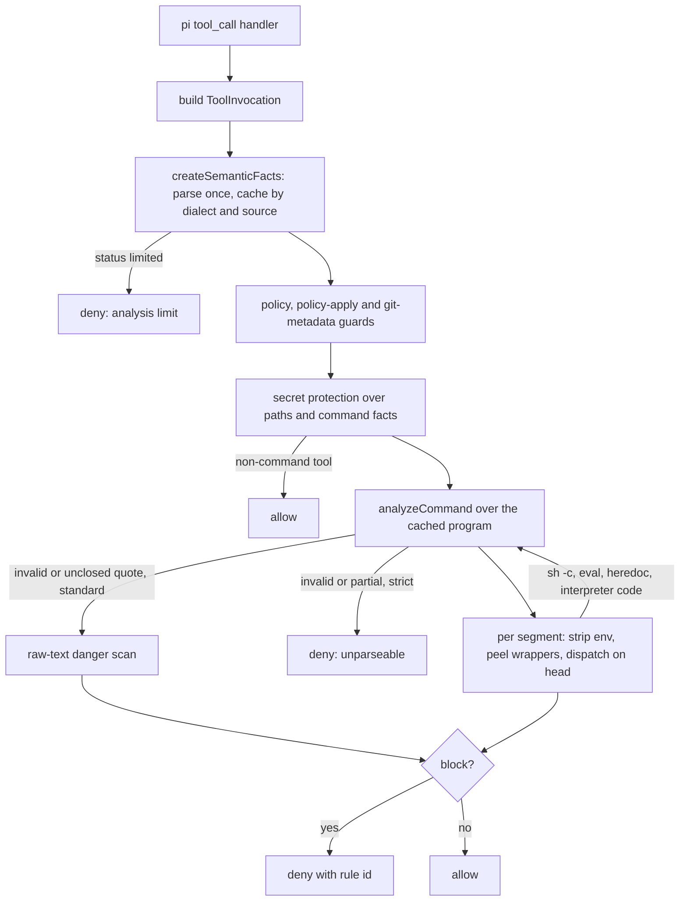

# cc-safety-net: shell analysis and lessons for pi-verdict

Read on 2026-11-02 from cc-safety-net 2.7.1, commit `755a548` (https://github.com/kenryu42/cc-safety-net). Citations are `path:line` at that
commit. "Verified" means read in source; "inferred" means concluded from structure or docs without tracing every path.

The project is MIT-licensed (`LICENSE`): copying code is allowed if the copyright notice and licence text travel with it. Its parser is
tuned to a deny-only model, so this note adopts ideas, not code.

## Recommendations for pi-verdict

1. **Give the shared reading a typed word model with a parse status (TODO item 5).** cc-safety-net parses each command into words. Each word
   keeps its decoded text, its raw spelling, a quoted flag, and a provenance: literal, variable, command substitution, arithmetic, glob or
   unknown. Commands keep redirections and nested programs, and the whole program has a status: complete, partial, invalid or limited.
   pi-verdict's `shellWords` returns plain strings, so it loses exactly the facts behind item 3's open gaps: an unquoted `$(…)` that splits
   segments, `<(…)` not marked unsound, brace expansion, and `git push$NOPE`. The gain is coverage and fewer bypass classes, because a layer
   can ask whether a word is literal. The cost is rewriting `shell-words.ts` as a small subset parser, not porting the 1,816-line
   `posix.ts`. A non-complete status maps to the existing unsound sentinel, which sends the call to the classifier.

2. **Parse once per call through a memoized store (TODO item 5).** A per-call store caches each program by dialect and source text, and
   every guard and the analyzer read from it (`src/gate/guards/semantic-facts.ts:136-170`; verified). In pi-verdict this would be one object
   on the rule context that `classifyByRules`, the floor, `allowAdmits` and `allow-operands.ts` share. The gain is consistency, not speed
   (the rule layer already costs 0.1-1 ms), at low cost.

3. **Collect every analysis cap in one budget table (TODO item 5).** `src/core/budget.ts:30-80` holds one frozen table of caps; for example,
   10 levels of recursion, 16,384 derived tokens and 20 wrapper peels. A per-call `charge()` throws one typed `AnalysisLimit`, and the
   pipeline turns it into a fail-closed decision (`src/gate/pipeline.ts:485-505`). pi-verdict's caps are scattered across modules
   (`BASH_MAX_MATCH_LEN`, `MAX_GRADED_OPERANDS`, the `anyCommandIn` depth). One table with one breach path to the over-cap ask would make
   them easier to review and test. The cost is small.

4. **Add seeded fuzzing with invariants and rule reachability to the tests (TODO item 5's differential tests).** cc-safety-net generates
   2,000 commands from a seeded fragment alphabet, wrapping them in substitutions, quotes and heredocs. It asserts that each verdict is
   well-formed and that the fuzz reached every rule (`tests/helpers/shell-inputs.ts:298-310`, `tests/gate/harvested.test.ts:279-415`;
   verified). This finds parser disagreements before a review round does, for the cost of one test file.

5. **Pin each accepted residual with a case (ADR-0009, `probe/cases.ts`).** Its residual-risk registry gives every accepted bypass family a
   structured entry. Each entry also needs a strict-mode fixture that pins the fail-closed outcome (`docs/residual-risk.md:1-50`,
   `docs/residual-risk-registry.json`, 15 families). pi-verdict's residuals are prose in ADR-0009. One probe case per residual, asserting
   today's ask or classifier route, would cheaply catch a silent regression to allow.

6. **Test linearity with growth ratios, not wall-clock limits (tests).** Its tests compare the fastest of several runs at input sizes n and
   8n and require the ratio to stay under a bound (`tests/gate/analyzer/analyze-command.test.ts:139-148`). They also count scan work units
   (`tests/gate/analyzer/mid.test.ts:180-190`). Applied to `shellWords` and the floor regexes at the 8,192-character cap, this guards the
   measured cost on any machine, cheaply.

Three ideas are not worth adopting. Its hand-written linear scanners replace regex tripwires, but pi-verdict's regexes are already cheap on
capped input. Its standard mode allows unparseable text that matches no tripwire, whereas pi-verdict's classifier route is stricter. Its
standard-mode exemptions fill one long paragraph (`SECURITY.md:34`), which shows how static rules grow when no model handles the gray zone.

## Analysis pipeline

## 1. Shell model

The parser builds a tree, not a token list (`src/core/shell/model.ts:1-151`; verified). A `CommandProgram` holds nodes: commands,
connectors, subshell or brace groups, function definitions and unknown spans. Each `CommandView` holds its words, its redirections with
heredoc bodies, and nested programs for substitutions. A `CommandWord` carries `text`, `raw`, `span`, `quoted`, `provenance` and `parts`.
`$'…'` is decoded to its value (`src/core/shell/posix.ts:561-580`, `1209-1232`). Comments are skipped to the end of the line
(`posix.ts:191-194`). Heredoc bodies are read after the newline and attached to their redirection (`posix.ts:172-178`,
`src/core/shell/heredoc.ts:71`). Several constructs make the status `invalid`: an invalid code point, a heredoc error, a function
substitution, an unclosed `${`, or an unsupported blank character (`posix.ts:1281-1301`).

Wrappers are peeled in stages (verified): prefix assignments first, then `sudo`, `env`, `command` and `builtin` with their option tables, at
most 20 times (`src/gate/analyzer/wrapper-prelude.ts:46-140`). Transparent wrappers such as `nice`, `nohup`, `timeout`, `stdbuf`, `time` and
`exec` come last (`src/gate/analyzer/transparent-wrappers.ts:15-24`). Bodies passed to `sh -c`, `eval`, heredocs read as shell, and
interpreter code are re-parsed through `analyzeNested` at depth + 1 (`src/gate/analyzer/segment.ts:295-360`, `analyze-command.ts:392`,
`605-616`). An unidentifiable command string is denied as a dynamic shell source.

When it cannot parse, the outcome depends on the mode (verified). A `limited` program is denied (`pipeline.ts:148-176`,
`analyze-command.ts:113-121`). In strict mode, `invalid` and `partial` programs are denied. In standard mode, a heredoc problem or an
unclosed quote falls back to the raw-text scan and is allowed when no pattern matches (`analyze-command.ts:123-158`, `1800-1825`;
`SECURITY.md:32`). The parse happens once per call and is shared (recommendation 2). Derived bodies are parsed again, as they must be.

## 2. Cost control

`budget.ts` holds the caps and the `charge()` meter described in recommendation 3. Parser limits are separate: 131,072 code units, 16,384
words and 64 levels of nesting, each returning a `limited` program (`model.ts:153-163`, `posix.ts:73-91`, `201-205`). The "linear danger
scanner" consists of single-pass character scanners for `rm -rf`, the git reset, clean, push, branch and tag forms, and `find -delete`
(`src/gate/analyzer/linear-danger-scanner.ts:17-59`). A shared work counter meters each pass (`text-scanner.ts:1-28`). These scanners run
only on text the parser could not read, on interpreter code, and on `xargs` or `parallel` templates (`dangerous-text.ts:6-60`). The test
suite pins linearity with growth ratios and cold-start time with a bound of node start-up plus 150 ms
(`tests/e2e/hook-cold-start.test.ts:60-90`). The source states no per-call timing; this note did not measure it.

## 3. Rule representation

The built-in rules are procedural predicates over the token list of each command. An `ANALYZER_RULES` table dispatches on the head word
(`src/gate/analyzer/rule.ts:77-117`), and per-subcommand functions apply option tables (`src/gate/analyzer/git/rules.ts:57-154`).
`src/core/rules/destructive.ts` is a metadata catalog of 74 rule ids, each with a label, an example and a block intent, not a set of
matchers (verified). User rules are declarative. A user rule names a `command`, an optional `subcommand` and `block_args`, or a
`command_path` with `any_args` and `exclude_args`. The matcher compares tokens and skips global options that take values
(`src/core/rules/custom.ts:6-80`, `types.ts:3-21`). It never runs a regex over raw text. Regexes remain only as four of the raw-text
fallback patterns (`dangerous-text.ts:30-42`).

## 4. Coverage choices

The static rules cover destructive git operations, recursive deletes resolved against the working directory, `find`, `xargs`, `parallel`,
interpreters, PowerShell, secret paths, its own policy files and git metadata (`pipeline.ts:178-280`). Secret rules match basenames,
extensions, prefixes and home paths, on file tools and command operands alike (`src/core/rules/secret.ts:1-40`). Standard mode exempts
metadata-only reads and assumes a non-adversarial agent (`SECURITY.md:34-46`). State is tracked within one command: working directory,
written and downloaded paths, heredoc files and function definitions (`analyze-command.ts:160-185`). No state crosses calls; the only
session id goes to the audit log (`src/core/audit.ts:21`; verified by search). It therefore has no counterpart to pi-verdict's session
shell-state guard (inferred).

## 5. Testing

Behaviour is pinned by contract corpora (`tests/gate/behavioral-contract-cases.ts`, 3,390 lines) and a hand-edited table of 6,983 harvested
verdicts. The table records one verdict per safety level, and the replay checks every row (`AGENTS.md:73-80`,
`tests/gate/harvested.test.ts:139-240`). A behaviour change must first appear as a failing row; seeded fuzzing completes the set
(recommendation 4). The contract corpus is the closest counterpart to pi-verdict's probe case table, and its per-level columns resemble the
probe's three runs (inferred). `evals/` tests the agent skill that explains blocks, not the rules (verified).

## 6. pi host integration and coexistence

The pi entry registers one `tool_call` handler and some slash commands (`src/entries/pi/index.ts`). The handler returns `{block: true,
reason}` or `undefined`, and it never asks (`src/hosts/pi/tool-call.ts:44-127`). It treats `bash` and `powershell` as commands and sends
every other tool to the path checks. A handler exception becomes a block (`src/hosts/hook/plugin-adapter.ts:72-74`, `119`). omp runs
`tool_call` handlers one after another in extension order, and the first block wins
(`packages/coding-agent/src/extensibility/extensions/runner.ts:1945-1990` in the omp source at v18.13.0, commit `011ab732fa`; verified). The two gates can
therefore share a session. Neither can weaken the other: a call goes through only if both let it pass (inferred). Two side effects follow.
If cc-safety-net runs first, its denies never reach pi-verdict's audit log. If pi-verdict runs first, a user may approve an ask that
cc-safety-net then denies.
